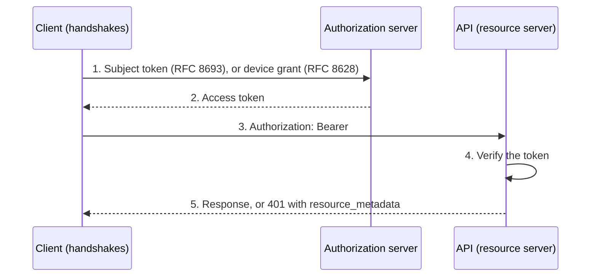
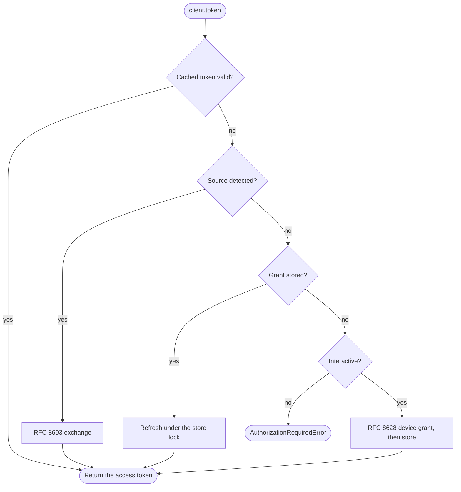
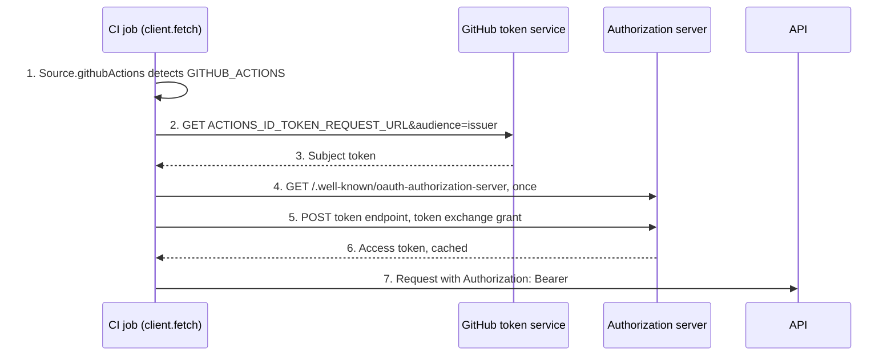
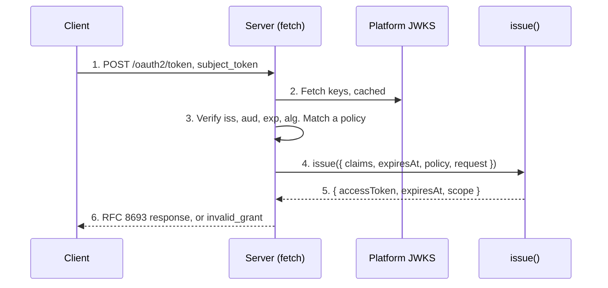

# Handshakes implementation plan

Status: phase 0 done. Phase 1 is next.

Handshakes is an OAuth client library and CLI that replaces stored API keys with short-lived access tokens.

- In CI and on servers, it exchanges the platform's OIDC token for an access token ([RFC 8693](https://www.rfc-editor.org/rfc/rfc8693)).
- On a laptop, it runs the device authorization grant ([RFC 8628](https://www.rfc-editor.org/rfc/rfc8628)) and refreshes the grant.
- `handshakes/server` serves the token exchange as a fetch handler, and verifies access tokens for an API. `handshakes/better-auth` adds the same exchange to a [Better Auth](https://www.better-auth.com) authorization server. Both sides of the handshake ship and test together.

The client calls only standard OAuth endpoints, so it works with any authorization server that implements them, such as Better Auth, Google, or OpenRouter. The server entry implements only the token exchange endpoint and token verification. The host issues the credential.

## Goals

- Code that calls an API stores no long-lived credential.
- One resolution order for every runtime: CI, serverless, containers, and laptops.
- Only standard endpoints and standard terms.
- No dependencies in the core entry.

## Non-goals

- A full authorization server. The server entry stores no tokens and runs no device grant, consent, or client registration.
- A secret vault.
- Browser sign-in.
- Onchain access keys.

## Roles

Handshakes covers the three roles of OAuth.



| Role                 | Entry                                                       | Responsibility                                                                                      |
| -------------------- | ----------------------------------------------------------- | --------------------------------------------------------------------------------------------------- |
| Client               | `handshakes`, `handshakes/node`, the CLI                    | Detect the subject token or run the device grant, exchange or refresh, cache, and attach the token  |
| Authorization server | `handshakes/server` (`Server`), or `handshakes/better-auth` | Verify the subject token, match a policy, and return the credential that the host issues            |
| API                  | `handshakes/server` (`Resource`)                            | Verify the access token or a subject token, serve RFC 9728 metadata, and return the `401` challenge |

An API can take one of three setups:

| Setup                                 | Authorization server                                     | API                                                                        |
| ------------------------------------- | -------------------------------------------------------- | -------------------------------------------------------------------------- |
| Exchange for the API's own credential | `Server` in the API, with `issue` that mints an API key  | The existing check of the API key                                          |
| Exchange at a separate server         | Better Auth with `tokenExchange`, or any RFC 8693 server | `Resource` with `authorizationServers`                                     |
| No exchange                           | None                                                     | `Resource` with `policies`, which accepts platform subject tokens directly |

The client is the same in each setup. The last setup is the least work, but the API accepts a token for the full lifetime that the platform sets, and cannot narrow its scopes.

## Model

| Term          | Meaning                                                                                              |
| ------------- | ---------------------------------------------------------------------------------------------------- |
| Subject token | A JWT that the platform signs for the running code, such as a GitHub Actions OIDC token              |
| Access token  | The token that the API verifies. It expires in minutes                                               |
| Grant         | A stored access token and refresh token from the device grant                                        |
| Source        | Where a subject token comes from, such as GitHub Actions or Vercel                                   |
| Trust policy  | A server rule that maps the issuer and claims of a subject token to a client, scopes, and a lifetime |

## Resolution order

`Client` and the CLI resolve an access token the same way.



1. A cached access token is valid until 60 seconds or 20% of its lifetime remain, whichever is more.
2. The first source whose `detect` returns `true` supplies the subject token. If that source then fails, the client throws. It never falls through to the next source, since that can select a different identity.
3. A stored grant refreshes under a lock that covers every process using the store. Refresh tokens can rotate, and a server such as Better Auth revokes every refresh token of the client and user when an old one is reused.
4. The device grant runs only when stdin is a TTY and `CI` is not set, or when `interactive` is `true`.

## Exchange flow



1. The client detects the platform from environment variables.
2. It requests a subject token whose `aud` is the issuer, unless `subjectAudience` names another value.
3. GitHub returns a JWT with claims such as `repository_id` and `ref`.
4. The client reads the token endpoint from the server metadata, once per client.
5. It sends the subject token. The server matches its issuer and claims against a trust policy.
6. The server returns an access token. The client caches it.
7. The client sends the request.

Only steps 1 to 3 change between platforms.

## Standards

| Standard                 | Use                                   | Phase |
| ------------------------ | ------------------------------------- | ----- |
| RFC 8414, OIDC discovery | Endpoint discovery                    | 2     |
| RFC 8628                 | `authorize` on a laptop               | 2     |
| RFC 6749 refresh grant   | Keeping a stored grant current        | 2     |
| RFC 7009                 | `revoke`                              | 2     |
| RFC 8693                 | Token exchange, client and server     | 3     |
| RFC 8707                 | `resource`                            | 3     |
| RFC 9728                 | `Client.discover`, `handshakes fetch` | 4     |
| RFC 9449 (DPoP)          | Grants bound to a key                 | 5     |

## Package

One package, `handshakes`, with five entries and a bin.

| Entry                    | Contents                                                                       |
| ------------------------ | ------------------------------------------------------------------------------ |
| `handshakes`             | `Client`, `DeviceGrant`, `Exchange`, `Identity`, `Metadata`, `Source`, `Store` |
| `handshakes/server`      | `Policy`, `Resource`, `Server`                                                 |
| `handshakes/better-auth` | `tokenExchange`                                                                |
| `handshakes/node`        | `NodeSource`, and `Store` with `file` and `keychain`                           |
| `handshakes/test`        | `Issuer`                                                                       |
| bin `handshakes`         | The CLI                                                                        |

- The core entry has no dependencies. It runs in Node, Bun, Deno, and edge runtimes.
- `handshakes/node` uses `fs` and child processes.
- `handshakes/server` has no dependencies. It verifies RS256 and ES256 signatures with WebCrypto, so it runs on edge runtimes too.
- `@vercel/oidc`, `better-auth`, and `@better-auth/oauth-provider` are optional peers.

## TypeScript API

### Conventions

- `expiresAt` is always in milliseconds. Server lifetimes are in seconds, as in OAuth's `expires_in`.
- Every function that reads the environment or the network takes `env` and `fetch` options. Tests inject them, and nothing stubs a global.
- Token values never appear in errors, logs, or `status`.

### `Client`

Returns access tokens for one API, through the resolution order.

```ts
import { Client } from 'handshakes'

const client = Client.create({ issuer: 'https://id.example.com', scope: 'data:read' })
const response = await client.fetch('https://api.example.com/v1/items')
```

```ts
declare function create(options: create.Options): Client

declare namespace create {
  type Options = {
    /** OAuth client for `authorize` and refresh. Required on a laptop. */
    clientId?: string | undefined
    /** Client secret, for servers that require one on the device grant, such as Google. */
    clientSecret?: string | undefined
    /** Explicit endpoints, for servers without metadata. Overrides the metadata of `issuer`. */
    endpoints?: Endpoints | undefined
    /** Environment that sources read. Default: `process.env`. */
    env?: Env | undefined
    /** Used for every request. Default: `globalThis.fetch`. */
    fetch?: typeof globalThis.fetch | undefined
    /** Runs `authorize` when no other method applies. Default: `true` when stdin is a TTY and `CI` is not set. */
    interactive?: boolean | undefined
    /** Authorization server. Required unless `endpoints.token` is set. */
    issuer?: string | undefined
    /** Receives the user code during `authorize`. Default: prints it to stderr. */
    onDeviceCode?: ((code: DeviceGrant.Code) => void) | undefined
    /** Extra fields of the token request, such as OpenRouter's `federation_policy_id`. */
    parameters?: PerSource<Record<string, string>> | undefined
    /** RFC 8707 resource of the access token. */
    resource?: string | undefined
    /** Space-separated scopes. */
    scope?: string | undefined
    /** Sources in priority order. Default: `Source.defaults`. */
    sources?: readonly Source[] | undefined
    /** Where grants persist. Default: `Store.memory()`. */
    store?: Store | undefined
    /** `aud` of the subject token. Default: `issuer`. */
    subjectAudience?: PerSource<string> | undefined
  }
}

/** A value, or a function of the detected source, such as the per-provider `audience` of Google STS. */
type PerSource<value> = value | ((source: Source) => value)

type Client = {
  /** Runs the device grant and stores the grant. */
  authorize: (options?: { signal?: AbortSignal | undefined }) => Promise<Grant>
  /** `fetch` with `Authorization: Bearer`. After a 401, retries once with a new token. */
  fetch: typeof globalThis.fetch
  /** Removes the cached access token. */
  invalidate: () => void
  /** Revokes the refresh token and deletes the stored grant. */
  revoke: () => Promise<void>
  /** The method that applies, the subject, and the expiry. */
  status: () => Promise<Status>
  /** Returns the cached access token, or requests a new one. */
  token: () => Promise<AccessToken>
}

/** Reads the RFC 9728 metadata of an API, then creates a client for the authorization server that it names. */
declare function discover(options: discover.Options): Promise<Client>

declare namespace discover {
  type Options = Omit<create.Options, 'endpoints' | 'issuer' | 'resource'> & {
    /** The protected API, such as `https://api.example.com`. */
    resource: string
  }
}
```

### `Identity`

Returns the subject token itself, for APIs that accept platform tokens directly, such as Vercel AI Gateway.

```ts
declare function token(options: token.Options): Promise<Token>

declare namespace token {
  type Options = {
    /** `aud` of the token. Required, so a token for one service never reaches another. */
    audience: string
    /** Default: `process.env`. */
    env?: Env | undefined
    /** Default: `globalThis.fetch`. */
    fetch?: typeof globalThis.fetch | undefined
    /** Default: `Source.defaults`. */
    sources?: readonly Source[] | undefined
  }
}

/** Returns the first source that detects its platform. Reads environment variables only. */
declare function detect(options?: detect.Options): Source | undefined
```

### `Source`

```ts
type Source = {
  /** Checks environment variables only, with no I/O. */
  detect: (env: Env) => boolean
  /** Name in `Token.source`, `status`, and errors, such as `githubActions`. */
  name: string
  /** Returns a JWT for `audience`. */
  token: (options: Source.token.Options) => Promise<string>
}
```

| Source                   | Detects                       | Request                                                                          | Audience                                 |
| ------------------------ | ----------------------------- | -------------------------------------------------------------------------------- | ---------------------------------------- |
| `Source.vercel()`        | `VERCEL`, `VERCEL_OIDC_TOKEN` | Request header, token file, or env. Another audience goes through `@vercel/oidc` | Any                                      |
| `Source.githubActions()` | `GITHUB_ACTIONS`              | `GET` `ACTIONS_ID_TOKEN_REQUEST_URL` with `audience`, and the request token      | Any                                      |
| `Source.gitlab()`        | `GITLAB_CI`                   | Reads `<AUD>_ID_TOKEN`, or the `variable` option                                 | Fixed in `id_tokens` of `.gitlab-ci.yml` |
| `Source.circleci()`      | `CIRCLECI`                    | Reads `CIRCLE_OIDC_TOKEN_V2`                                                     | Fixed                                    |
| `Source.gcp()`           | `K_SERVICE`                   | Metadata server, `…/service-accounts/default/identity?audience=`                 | Any                                      |
| `NodeSource.buildkite()` | `BUILDKITE`                   | `buildkite-agent oidc request-token --audience`                                  | Any                                      |
| `NodeSource.file()`      | The file exists               | Reads a projected token, such as a Kubernetes service account token              | Fixed in the pod spec                    |

- `Source.defaults` is `[vercel, githubActions, gitlab, circleci, gcp]`, in priority order. `NodeSource.defaults` adds `buildkite`.
- `Source.from(source)` types a custom source.
- For a source with a fixed audience, the client decodes the token and compares `aud` with the requested audience. A mismatch throws `Identity.AudienceError`, and the token is not sent.
- `Source.vercel` returns the token without an exchange when its `aud` already matches, such as `https://vercel.com/<team>` for AI Gateway.
- Compute Engine and GKE set no variable to detect. List `Source.gcp()` explicitly there.

### `Store`

```ts
type Store = {
  /** Removes the grant. */
  delete: (key: string) => Promise<void>
  /** Returns the grant, if one is stored. */
  get: (key: string) => Promise<Grant | undefined>
  /** Runs `fn` under a lock that covers every process using this store. */
  lock: <result>(key: string, fn: () => Promise<result>) => Promise<result>
  /** Writes the grant. */
  set: (key: string, grant: Grant) => Promise<void>
}
```

| Store                                      | Entry             | Behavior                                                                                                                            |
| ------------------------------------------ | ----------------- | ----------------------------------------------------------------------------------------------------------------------------------- |
| `Store.memory()`                           | `handshakes`      | One process only                                                                                                                    |
| `Store.from(store)`                        | `handshakes`      | Types a custom store                                                                                                                |
| `Store.file({ directory?, lockTimeout? })` | `handshakes/node` | Default directory `~/.config/handshakes/grants`. Mode 0600, atomic writes, a lock file with a stale timeout, a read after each lock |
| `Store.keychain({ service? })`             | `handshakes/node` | macOS `security`, Linux `secret-tool`                                                                                               |

The store key is the issuer and the client ID.

### `DeviceGrant`, `Exchange`, `Metadata`

The standard requests that `Client` uses, exported for custom flows.

```ts
// RFC 8628
declare function start(options: start.Options): Promise<DeviceGrant>

declare namespace start {
  type Options = {
    clientId: string
    clientSecret?: string | undefined
    endpoints?: Endpoints | undefined
    fetch?: typeof globalThis.fetch | undefined
    issuer?: string | undefined
    resource?: string | undefined
    scope?: string | undefined
  }
}

type Code = {
  /** When the user code expires. */
  expiresAt: number
  userCode: string
  verificationUri: string
  verificationUriComplete?: string | undefined
}

type DeviceGrant = Code & {
  /** Polls at the server's interval, and slows down when the server requests it. Resolves on approval. */
  wait: (options?: { signal?: AbortSignal | undefined }) => Promise<Grant>
}
```

```ts
// RFC 8693
declare function request(options: request.Options): Promise<AccessToken>

declare namespace request {
  type Options = {
    /** RFC 8693 `audience` field. */
    audience?: string | undefined
    clientId?: string | undefined
    clientSecret?: string | undefined
    endpoint: string
    fetch?: typeof globalThis.fetch | undefined
    parameters?: Record<string, string> | undefined
    /** Default: `urn:ietf:params:oauth:token-type:access_token`. */
    requestedTokenType?: string | undefined
    resource?: string | undefined
    scope?: string | undefined
    subjectToken: string
    /** Default: `urn:ietf:params:oauth:token-type:jwt`. */
    subjectTokenType?: string | undefined
  }
}
```

```ts
// RFC 8414 and RFC 9728
Metadata.authorizationServer(options: { fetch?; issuer: string }): Promise<AuthorizationServer>
Metadata.protectedResource(options: { fetch?; resource: string }): Promise<ProtectedResource>
/** Parses `WWW-Authenticate`: `resource_metadata`, `scope`, and `error`. */
Metadata.challenge(response: Response): Challenge | undefined
```

### Types

```ts
type AccessToken = {
  /** When the token expires. */
  expiresAt: number
  /** `exchange`: from a subject token. `grant`: from a stored or new grant. */
  method: 'exchange' | 'grant'
  scope?: string | undefined
  /** `DPoP` when the token is bound to a key. */
  type: 'Bearer' | 'DPoP'
  value: string
}

type Endpoints = {
  deviceAuthorization?: string | undefined
  revocation?: string | undefined
  token: string
}

type Env = Readonly<Record<string, string | undefined>>

type Grant = {
  accessToken: string
  clientId: string
  /** When the access token expires. */
  expiresAt: number
  issuer: string
  refreshToken?: string | undefined
  scope?: string | undefined
}

type Status =
  | { expiresAt: number; method: 'exchange'; source: string; subject: string }
  | {
      expiresAt: number
      method: 'grant'
      refreshable: boolean
      store: string
      subject?: string | undefined
    }
  | { checked: readonly string[]; interactive: boolean; method: 'none' }

type Token = {
  /** Claims, not verified. For logs and errors only. */
  claims: Readonly<Record<string, unknown>>
  expiresAt: number
  /** Name of the source, such as `githubActions`. */
  source: string
  value: string
}
```

### Errors

| Error                               | Thrown when                                                                                | Fields                                |
| ----------------------------------- | ------------------------------------------------------------------------------------------ | ------------------------------------- |
| `Client.AuthorizationRequiredError` | No source detects, no grant is stored, and the client is not interactive                   | `issuer`                              |
| `DeviceGrant.DeniedError`           | The user denies the code                                                                   |                                       |
| `DeviceGrant.ExpiredError`          | The code expires before approval                                                           |                                       |
| `Exchange.RejectedError`            | The server returns an RFC 6749 §5.2 error                                                  | `error`, `errorDescription`, `status` |
| `Identity.AudienceError`            | A token with a fixed audience has another `aud`                                            | `expected`, `received`, `source`      |
| `Identity.NotFoundError`            | No source detects                                                                          | `audience`, `checked`                 |
| `Metadata.NotFoundError`            | The issuer or resource serves no metadata                                                  | `url`                                 |
| `Source.RequestError`               | The detected source fails. The hint states the fix, such as `permissions: id-token: write` | `hint`, `source`                      |
| `Store.LockTimeoutError`            | Another process holds the lock past `lockTimeout`                                          | `key`                                 |

### `handshakes/test`

A local OIDC issuer for integration tests. It also serves GitHub's token request endpoint, so `Source.githubActions` runs unchanged against it.

```ts
import { Identity } from 'handshakes'
import { Issuer } from 'handshakes/test'

const issuer = await Issuer.create()
const jwt = await issuer.sign({
  audience: 'https://id.example.com',
  claims: { ref: 'refs/heads/main', repository_id: '812345' },
  expiresIn: 300,
  preset: 'githubActions',
})
const env = issuer.env({ preset: 'githubActions' })
const token = await Identity.token({ audience: 'https://id.example.com', env })
await issuer.close()
```

### `handshakes/server`

The server side of the handshake. Each part is framework-neutral: a fetch handler, or a function of a `Request`.

| Export     | Role                                                                                            |
| ---------- | ----------------------------------------------------------------------------------------------- |
| `Server`   | The RFC 8693 token endpoint and its RFC 8414 metadata. The host issues the credential.          |
| `Resource` | Verification of the tokens that an API receives, the RFC 9728 metadata, and the `401` challenge |
| `Policy`   | Trust policies that map a subject token to scopes and a lifetime                                |

#### `Server`



```ts
import { Policy, Server } from 'handshakes/server'

const server = Server.create({
  // Mints the credential of the host. `expiresAt` already ends no later than the subject token.
  issue: async (context) => ({
    accessToken: await keys.mint({ expiresAt: context.expiresAt, scopes: context.policy.scopes }),
    expiresAt: context.expiresAt,
  }),
  issuer: 'https://api.example.com',
  policies: [
    Policy.githubActions({
      audience: 'https://api.example.com',
      ref: 'refs/heads/main',
      repositoryId: '812345',
      scopes: ['data:read'],
    }),
  ],
})

// Serves POST /oauth2/token and /.well-known/oauth-authorization-server.
export default { fetch: server.fetch }
```

```ts
declare function create(options: create.Options): Server

declare namespace create {
  type Options = {
    /** Default: `globalThis.fetch`, for JWKS requests. */
    fetch?: typeof globalThis.fetch | undefined
    /** Mints the credential that the response returns. */
    issue: (context: IssueContext) => Promise<Issued>
    /** `issuer` of the metadata, and the default `aud` of subject tokens. */
    issuer: string
    /** In seconds. Caps every issued credential. Default: 900. */
    maxLifetime?: number | undefined
    /** Policies, or a function that loads them for a request, such as from a database. */
    policies: readonly Policy[] | ((request: Request) => Promise<readonly Policy[]>)
  }
}

type IssueContext = {
  /** Verified claims of the subject token. */
  claims: Readonly<Record<string, unknown>>
  /** The latest expiry the credential may have: the subject token's `exp`, the policy, and `maxLifetime`. */
  expiresAt: number
  /** The matched policy. */
  policy: Policy
  request: Request
}

type Issued = {
  accessToken: string
  expiresAt: number
  /** Default: the scopes of the policy. */
  scope?: string | undefined
}

type Server = {
  /** Serves the token endpoint and the metadata. Other paths return `404`. */
  fetch: (request: Request) => Promise<Response>
}
```

#### `Resource`

An API that receives tokens uses `Resource`. It accepts two kinds of token:

| Kind                         | Issuer                                                    | Option                 |
| ---------------------------- | --------------------------------------------------------- | ---------------------- |
| Access token, RFC 9068 JWT   | An authorization server, such as Better Auth              | `authorizationServers` |
| Subject token, used directly | A platform, such as GitHub Actions or Vercel. No exchange | `policies`             |

If `Server` issues the host's own credential, such as an API key, the API checks that credential as before and needs no `Resource`.

```ts
import { Resource } from 'handshakes/server'

const resource = Resource.create({
  authorizationServers: ['https://auth.example.com'],
  resource: 'https://api.example.com',
})

// RFC 9728 metadata names the authorization server, so clients discover it.
app.get('/.well-known/oauth-protected-resource', () => resource.metadata())

app.use(async (c, next) => {
  const result = await resource.verify(c.req.raw)
  // 401 with `WWW-Authenticate: Bearer resource_metadata="…", error="invalid_token"`
  if (result.status === 'invalid') return resource.challenge(result)
  c.set('principal', result.principal)
  await next()
})
```

```ts
declare function create(options: create.Options): Resource

declare namespace create {
  type Options = {
    /** Issuers whose RFC 9068 access tokens the API accepts. */
    authorizationServers?: readonly string[] | undefined
    fetch?: typeof globalThis.fetch | undefined
    /** Platform subject tokens that the API accepts without an exchange. */
    policies?: readonly Policy[] | undefined
    /** The API itself. Every accepted token has it as `aud`. */
    resource: string
    /** Scopes that every request needs. */
    scopes?: readonly string[] | undefined
  }
}

type Resource = {
  /** Returns the `401` response with the RFC 6750 and RFC 9728 `WWW-Authenticate` header. */
  challenge: (result: Invalid) => Response
  /** Returns the RFC 9728 metadata response. */
  metadata: () => Response
  /** Verifies the bearer token of the request. Never throws for a bad token. */
  verify: (request: Request) => Promise<Valid | Invalid>
}

type Valid = { principal: Principal; status: 'valid' }
type Invalid = {
  error: 'insufficient_scope' | 'invalid_request' | 'invalid_token'
  status: 'invalid'
}

type Principal = {
  claims: Readonly<Record<string, unknown>>
  expiresAt: number
  issuer: string
  /** Set for a subject token that a policy accepted. */
  policy?: Policy | undefined
  scopes: readonly string[]
  subject: string
}
```

- An access token needs `typ: at+jwt`, so an ID token signed with the same key does not pass.
- `aud` must equal `resource` exactly. An authorization server that issues one `aud` for every API does not meet this, and needs RFC 8707 resources.

#### `Policy`

```ts
type Policy = {
  /** Exact `aud` of the subject token. */
  audience: string
  /** Exact claim matches. An array matches any of its values. */
  claims: Readonly<Record<string, string | readonly string[]>>
  /** OAuth client that receives the issued token. Used by the Better Auth adapter. */
  clientId?: string | undefined
  id: string
  /** Exact `iss`. Keys come from its JWKS. */
  issuer: string
  /** In seconds. The issued credential also expires no later than the subject token. Default: 900. */
  maxLifetime?: number | undefined
  /** Scopes of the issued credential. */
  scopes: readonly string[]
}
```

- `Policy.githubActions({ audience, ref?, repositoryId, scopes, workflow? })` and `Policy.vercel({ audience, environment?, ownerId, projectId, scopes })` require identifiers that cannot change. A preset rejects a policy that matches names only, since a renamed or re-created repository keeps its name.
- `Policy.from(policy)` types a custom policy.
- Verification accepts RS256 and ES256 only, an exact `iss`, and an exact `aud`. It has no single-use `jti` rule, since Vercel reuses one subject token for up to 90 minutes.

### `handshakes/better-auth`

Adds the same exchange to `@better-auth/oauth-provider` through `extendOAuthProvider`. `issue` calls `provider.issueTokens`, so the client receives Better Auth access tokens.

```ts
import { betterAuth } from 'better-auth'
import { oauthProvider } from '@better-auth/oauth-provider'
import { Policy } from 'handshakes/server'
import { tokenExchange } from 'handshakes/better-auth'

export const auth = betterAuth({
  plugins: [
    oauthProvider({
      /* … */
    }),
    tokenExchange({ maxLifetime: 900 }),
  ],
})

await auth.api.createTrustPolicy({
  body: Policy.githubActions({
    audience: 'https://auth.example.com',
    clientId: 'ci',
    ref: 'refs/heads/main',
    repositoryId: '812345',
    scopes: ['data:read'],
  }),
})
```

- The plugin uses the `grants` slot, not `clientAuthentication`. The `clientAuthentication` contract requires a single-use `jti` and a lifetime of `assertionMaxLifetime` (300 seconds by default) or less.
- It adds a `trustPolicy` table, and the `createTrustPolicy`, `listTrustPolicies`, and `deleteTrustPolicy` endpoints.
- It records the `iss` and `sub` of the subject token with each issued token, for audit.

## CLI

```
handshakes <command> [profile] [options]

Commands
  authorize [profile]           Runs the device grant and stores the grant       (alias: login)
  revoke    [profile]           Revokes the refresh token, deletes the grant     (alias: logout)
  status    [profile]           Shows the method, subject, and expiry. Never prints tokens
  token     [profile]           Prints an access token to stdout
  token     --audience <aud>    Prints the subject token
  exec      [profile] -- <cmd>  Runs <cmd> with the access token in an env variable
  fetch     [profile] <url>     Sends a request with an access token. Without a profile, discovers the issuer from the API
  profiles                      Lists profiles and the file of each

Options
  --issuer <url>                Authorization server. Overrides the profile
  --client-id <id>              OAuth client for authorize and refresh
  --client-secret-env <NAME>    Reads the client secret from this env variable, never from argv
  --scope <scopes>              Space-separated scopes
  --resource <url>              RFC 8707 resource
  --audience <aud>              Subject token audience
  --source <name>               Uses only this source. Repeatable
  --no-interactive              Never runs the device grant. On when CI is set
  --json                        Machine-readable output
  --mcp                         Serves fetch and status as MCP tools

exec options
  --env <NAME>                  Variable for the token. Default: the env of the profile, else HANDSHAKES_TOKEN

fetch options
  -X, --method <method>         Default: GET, or POST with --data
  -H, --header <header>         Repeatable
  -d, --data <body|@file>       Request body
  -i, --include                 Prints the status and headers
  --fail                        Exits 22 on HTTP 400 or more, as curl does
```

The CLI uses incur, with one file per command.

### Profiles

The CLI reads `handshakes.json` from the nearest ancestor directory, then `~/.config/handshakes/config.json`. `HANDSHAKES_PROFILE` selects a profile, and `HANDSHAKES_CONFIG` names another file.

```json
{
  "default": "example",
  "profiles": {
    "example": {
      "clientId": "example-cli",
      "env": "EXAMPLE_API_KEY",
      "issuer": "https://id.example.com",
      "scope": "data:read"
    },
    "openrouter": {
      "endpoints": { "token": "https://openrouter.ai/api/v1/oauth/token" },
      "env": "OPENROUTER_API_KEY",
      "parameters": { "federation_policy_id": "<policy id>" },
      "subjectAudience": "https://openrouter.ai"
    },
    "gcp": {
      "endpoints": { "token": "https://sts.googleapis.com/v1/token" },
      "scope": "https://www.googleapis.com/auth/cloud-platform",
      "sources": {
        "githubActions": {
          "parameters": {
            "audience": "//iam.googleapis.com/projects/<number>/locations/global/workloadIdentityPools/<pool>/providers/github"
          }
        },
        "vercel": {
          "parameters": {
            "audience": "//iam.googleapis.com/projects/<number>/locations/global/workloadIdentityPools/<pool>/providers/vercel"
          }
        }
      }
    }
  }
}
```

`sources` holds overrides for each source, the JSON form of `PerSource`.

### Output

The primary output, a token or a response body, goes to stdout. Prompts and messages go to stderr.

```
$ handshakes authorize example
Open https://id.example.com/device?code=BCDF-GHJK and confirm BCDF-GHJK.
Authorized as user_01J… (refresh token expires in 30d)

$ handshakes status example --json
{ "expiresAt": 1792731000000, "method": "exchange", "source": "githubActions", "subject": "repo:acme/app:ref:refs/heads/main" }

$ handshakes exec example -- pnpm test
$ curl -H "Authorization: Bearer $(handshakes token example)" https://api.example.com/v1/items
$ handshakes fetch https://api.example.com/v1/items --fail
```

### Exit codes

| Code  | Meaning                                                          |
| ----- | ---------------------------------------------------------------- |
| 0     | Success                                                          |
| 1     | Unexpected error                                                 |
| 2     | Invalid usage                                                    |
| 3     | Authorization required: no source, no grant, and not interactive |
| 4     | Rejected by the server: `invalid_grant` on exchange or refresh   |
| 22    | `fetch --fail` received HTTP 400 or more                         |
| Other | `exec` returns the exit code of the child                        |

### MCP tools

| Tool     | Input                                         | Output                      |
| -------- | --------------------------------------------- | --------------------------- |
| `fetch`  | `profile`, `url`, `method`, `headers`, `body` | `status`, `headers`, `body` |
| `status` | `profile`                                     | `Status`                    |

There is no `token` tool, so a token never enters the context of a model.

## Conventions

- Tooling: pnpm with a catalog, Vite+ for Vitest, oxlint, and oxfmt, zile for the build, Changesets for releases, and incur for the CLI.
- TypeScript: one namespace per module, function types in a matching `declare namespace`, options bags, and classes for errors only.
- Error names are namespaced, such as `Client.AuthorizationRequiredError`.

## Testing

No mocks, stubs, or stubbed globals. Every test runs against a real server or a real platform.

| Layer                         | Real counterpart                                                                                                                 |
| ----------------------------- | -------------------------------------------------------------------------------------------------------------------------------- |
| Sources                       | `handshakes/test` issuer with `issuer.env()`, and a GitHub Actions job with `id-token: write`                                    |
| Device grant, refresh, revoke | A local Better Auth server: memory adapter, `oauthProvider`, `oauthDeviceAuthorization`, and `jwt`                               |
| Exchange                      | `Server` behind a local HTTP server, and the local Better Auth server with `handshakes/better-auth`, both fed by the test issuer |
| Resource                      | `Resource` against tokens of the local Better Auth server and of the test issuer                                                 |
| Interoperability              | Google STS from GitHub Actions in CI. Google OAuth by hand. OpenRouter when a Business plan is available                         |
| Races                         | Several processes that share one `Store.file`                                                                                    |
| CLI                           | The built bin against the local server                                                                                           |

`test/Server.ts` starts the local Better Auth server on a random port. A test approves a user code through the server's own approval endpoint, as a signed-in test user.

## Phases

### Phase 0: scaffold

- Repository, pnpm workspace, Vite+, zile, Changesets, CI (check, types, test), and a CLI that prints its help.
- The entries, empty.
- `test/Server.ts`.

Done when `pnpm check` and `pnpm test` pass, with one test that reads the metadata of the local server. Done in `6c60ac7`.

### Phase 1: subject tokens

- `Identity.token` and `Identity.detect`.
- `Source.githubActions`, `Source.vercel`, `Source.gitlab`, `Source.gcp`, `Source.from`, and `NodeSource.file`.
- The `aud` check for fixed audiences, and no fall-through after a detected source fails.
- `handshakes/test`: `Issuer.create`, `sign`, `env`, and `close`, with the `githubActions` and `vercel` presets.
- CLI: `token --audience`, and `status` for sources, both with `--json`.

Done when a GitHub Actions job verifies its own token against the JWKS of GitHub, and a request to Vercel AI Gateway succeeds with `handshakes token` after `vercel env pull`.

### Phase 2: grants on a laptop

- `Metadata.authorizationServer`, memoized for each issuer.
- `DeviceGrant.start` and `wait`, with `interval`, `slow_down`, `expired_token`, and `access_denied`.
- `Client.create` with steps 2 to 4 of the resolution order: `token`, `fetch`, `authorize`, `revoke`, `status`, and `invalidate`.
- The cache, with one request in flight for each client.
- `Store.memory`, `Store.from`, and `Store.file`.
- CLI: `authorize`, `revoke`, `status`, `token [profile]`, `exec`, `profiles`, and the profile files.

Tests:

- A full device grant against the local server.
- Rotation: the server rejects the old refresh token after a refresh.
- Race: ten processes with one expired grant make exactly one refresh, and the server revokes nothing.
- The server rejects the access token after `revoke`.
- Without a TTY, the client throws and never prompts.

Done when `authorize` and `exec` work against the local server and Google OAuth, and the race test passes 100 runs in a row.

### Phase 3: token exchange

Client:

- `Exchange.request`, with RFC 6749 §5.2 errors as `Exchange.RejectedError`.
- Step 1 of the resolution order in `Client.create`.
- `parameters` and `subjectAudience` as functions of the source.
- `endpoints` for servers without metadata.

Server, `handshakes/server`:

- `Server.create`: the token endpoint, its metadata, and `issue`.
- JWKS fetch and cache, RS256 and ES256 with WebCrypto, exact `iss` and `aud`, and a lifetime that ends no later than the subject token.
- `Policy.githubActions`, `Policy.vercel`, and `Policy.from`.

Server, `handshakes/better-auth`:

- `tokenExchange`, the `trustPolicy` table, and its endpoints.

Tests:

- Test issuer against `Server` and against the local Better Auth server: a match, a wrong repository, a wrong `aud`, an expired token, `alg: none`, and an unknown issuer.
- A GitHub Actions job that reads a Google Cloud Storage bucket through Google STS.
- OpenRouter, when a Business plan is available.

Done when a CI workflow with no secrets calls a protected API, and the same code runs on a Vercel preview.

### Phase 4: discovery, agents, more platforms

- `Resource.create`: `verify`, `metadata`, and `challenge`.
- `Metadata.protectedResource`, `Metadata.challenge`, and `Client.discover`.
- CLI: `fetch`, and `--mcp` with `fetch` and `status`.
- `Source.circleci` and `NodeSource.buildkite`.
- `Store.keychain`.
- GitHub App device flow, which has no metadata and needs `endpoints`.

Done when `handshakes fetch` works without a profile against an API that uses `Resource`, and an agent calls it through MCP.

### Phase 5: hardening and 1.0

- DPoP-bound grants where the server supports DPoP, so a copied store file is useless.
- A security review: token values in errors and logs, file permissions, and the env of `exec`.
- Docs: one guide for each platform, and examples for AI Gateway, OpenRouter, and Google STS.
- API freeze, and 1.0 through Changesets.
- A proposal of `handshakes/better-auth` to Better Auth.

## Test targets

| Target            | Path                                    | Setup                                                                                                                    |
| ----------------- | --------------------------------------- | ------------------------------------------------------------------------------------------------------------------------ |
| Vercel AI Gateway | Subject token, no exchange              | `vercel link` and `vercel env pull`, for a token valid 12 hours                                                          |
| OpenRouter        | RFC 8693 from GitHub Actions            | Business plan. An issuer for `https://token.actions.githubusercontent.com` and a policy                                  |
| Google STS        | RFC 8693 from GitHub Actions and Vercel | A workload identity pool with a provider for each platform                                                               |
| Google OAuth      | Device grant, refresh, revoke, metadata | An OAuth client of type "TVs and Limited Input devices". The device flow allows few scopes, so the test reads `userinfo` |
| Local Better Auth | Everything, and refresh races           | `test/Server.ts`                                                                                                         |

## Risks and open questions

- `extendOAuthProvider` is new in `@better-auth/oauth-provider`. Pin the version, and run the plugin tests on every upgrade.
- `handshakes/better-auth` can stay here or move to Better Auth after 1.0.
- File locks behave differently on Windows. Test the lock method there before phase 2 ends.
- `Source.vercel` depends on `@vercel/oidc` for other audiences. Own the request later if the peer becomes a problem.
- `exec` puts the token in the environment of the child, which other processes of the same user can read. This is acceptable for a token that expires in minutes.
- Google refresh tokens do not rotate, so only the local server exercises the refresh race.
