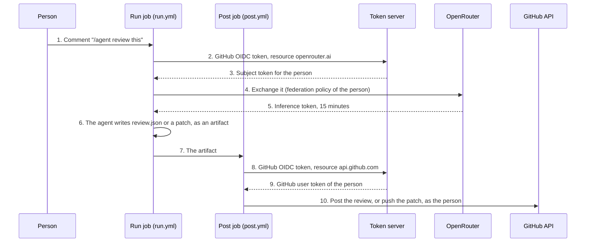

# Personal Agent: example plan

Status: planned. Nothing is built.

`examples/personal-agent/` is an example app for Handshakes. Each person has their own coding agent on GitHub. A comment `/agent <task>` on an issue or a pull request starts the agent of the person who wrote the comment. The agent works with that person's GitHub access and model budget, and no repository or job stores a secret.

The example shows three properties of Handshakes together:

- **Identity from the platform:** the GitHub Actions OIDC token names the person who triggered the job (`actor_id`), so one workflow serves every person.
- **Credentials per person:** a trust policy for each `actor_id` maps that person to their own GitHub token and model budget.
- **No token in the agent:** the agent has no GitHub credential, and its model key is limited in amount and lifetime.

## Prior art

| Product                                                             | What it does                                                                                                                                                                         | Difference                                                                           |
| ------------------------------------------------------------------- | ------------------------------------------------------------------------------------------------------------------------------------------------------------------------------------ | ------------------------------------------------------------------------------------ |
| [Vercel Agent Code Review](https://vercel.com/docs/agent/pr-review) | Reviews pull requests, and validates patches in a sandbox. `@vercel run a review` or `@vercel fix …` starts it.                                                                      | One bot for the team, on the team's Vercel account. It runs on Vercel projects only. |
| Claude Code GitHub Action (`@claude`), Copilot coding agent         | Answers mentions, reviews, and opens pull requests                                                                                                                                   | One bot identity, on repository or organization credentials, with a stored model key |
| OpenRouter, Cloudflare AI Gateway                                   | No first-party review bot. Cloudflare has a tutorial ([code review bot](https://developers.cloudflare.com/sandbox/sdk/tutorials/code-review-bot/)), and OpenRouter a cookbook recipe | Gateways only                                                                        |

## Model provider

| Gateway               | Keyless from GitHub Actions                                                                                                      | Messages API for Claude Code                                   | Decision                                      |
| --------------------- | -------------------------------------------------------------------------------------------------------------------------------- | -------------------------------------------------------------- | --------------------------------------------- |
| OpenRouter            | Yes. RFC 8693 at `https://openrouter.ai/api/v1/oauth/token`, with `federation_policy_id`. Business plan. Tokens last 15 minutes. | `ANTHROPIC_BASE_URL=https://openrouter.ai/api`                 | **Use**                                       |
| Vercel AI Gateway     | No. It accepts the Vercel OIDC token only, which exists on Vercel deployments                                                    | `https://ai-gateway.vercel.sh/claude-code`                     | Recipe only, for an agent that runs on Vercel |
| Cloudflare AI Gateway | No. Gateway tokens are stored keys, and no OIDC support is documented                                                            | `…/<account>/<gateway>/anthropic`, with `cf-aig-authorization` | Not used                                      |

OpenRouter maps a federated token to a workspace key, not to a person. So the example adds one hop: the token server signs a subject token for the person, and OpenRouter exchanges it under a federation policy for that person. Each person's workspace key carries their spend limit, and guardrails cap the member.

## Components

| Component       | Path                                          | Responsibility                                                                                                                                       |
| --------------- | --------------------------------------------- | ---------------------------------------------------------------------------------------------------------------------------------------------------- |
| Caller workflow | `examples/personal-agent/workflows/agent.yml` | Copied into each repository as `.github/workflows/agent.yml`. Starts on `/agent`, and calls the two reusable workflows.                              |
| Run workflow    | `examples/personal-agent/workflows/run.yml`   | Reusable. Runs the agent with the model token only, and uploads its output as an artifact.                                                           |
| Post workflow   | `examples/personal-agent/workflows/post.yml`  | Reusable. Downloads the artifact, and posts it with the GitHub token of the person. Runs no code from the checkout.                                  |
| Token server    | `examples/personal-agent/server/`             | Better Auth with GitHub sign-in, and Handshakes `Server`. Links a GitHub account, stores the settings of the person, and issues the two credentials. |
| Instructions    | A repository of the person, `<login>/.agent`  | `AGENT.md`, the standing instructions of the person, such as review style                                                                            |

## Flow

1. **Trigger:** a comment that starts with `/agent` on an issue, a pull request, or a review thread starts the workflow (`issue_comment`, `pull_request_review_comment`). The job runs only for an `author_association` of `OWNER`, `MEMBER`, or `COLLABORATOR`, so other accounts cannot spend runner minutes.
2. **Model token:** the run job exchanges its OIDC token at the token server with `resource=https://openrouter.ai`. The server matches the policy of the `actor_id` and of `run.yml`, and returns a subject token that it signs, with `sub` set to `github:<actor_id>`. The job exchanges that token at OpenRouter.
3. **Context:** the run job checks out the pull request, and reads `AGENT.md` from `<login>/.agent` with its read-only `GITHUB_TOKEN` if the repository is public. For a private instructions repository, the post job reads it in a first pass.
4. **Agent:** Claude Code runs headless with `ANTHROPIC_BASE_URL=https://openrouter.ai/api` and the inference token. It writes `review.json` for a review, or a patch for a change, and the job uploads it as an artifact.
5. **GitHub token:** the post job exchanges its OIDC token with `resource=https://api.github.com`. The server matches the policy of the `actor_id` and of `post.yml`, refreshes the GitHub App user token of the person, and returns it.
6. **Post:** the post job posts `review.json` as a `COMMENT` review, or applies the patch to the branch `agent/<login>/<number>`, pushes it, and opens a pull request. It runs `handshakes exec github -- …`, and runs no code from the checkout.

## Decisions

- **Trigger:** a `/agent` command, not a mention. A mention needs a GitHub account for each agent. The command names no one, because the agent always belongs to the author of the comment.
- **Installation:** a workflow file in each repository for the first version. It is the smallest setup, and it shows `actor_id` matching directly. A GitHub App that dispatches to `<login>/.agent` comes later.
- **Who may start an agent:** only its owner. The policy matches `actor_id`, so a comment by another person uses the agent of that other person, or fails if they have none. Delegation to named people comes later.
- **Repositories:** the person lists organization IDs in their settings. The policy matches `repository_owner_id` against that list, and against the ID of the person for their own repositories.
- **GitHub identity:** a GitHub App user token, so the review appears as the person and pushes reach only repositories that the person can write to. The App requests only `contents`, `issues`, `pull_requests`, and `metadata`. Each post carries a footer that names the agent.
- **Job split:** any step of a job with `id-token: write` can request the OIDC token, so the agent could request any credential that its job may receive. The run job and the post job are therefore separate reusable workflows. GitHub signs `job_workflow_ref` into the OIDC token of each, and each resource of the policy requires its workflow: `openrouter.ai` only for `run.yml`, and `api.github.com` only for `post.yml`. The agent can mint model tokens on its own budget, and never a GitHub token.
- **Agent permissions:** the agent writes no GitHub state. Trusted steps post COMMENT reviews only, never approvals, and push only to `agent/*` branches. A prompt injection in a pull request can produce a bad suggestion, but it cannot approve, merge, or delete.
- **Model key in the agent:** Claude Code needs the inference token in its environment. The token expires in 15 minutes and the workspace key of the person caps its spend, so a leak costs at most the remaining budget.
- **Instructions:** `AGENT.md` in `<login>/.agent`, read by a trusted step. The agent receives it as text, so it follows the person across repositories.
- **Token server host:** Vercel, with Better Auth on Postgres. It stores the GitHub App client secret and its own signing key. No repository and no job stores either.
- **Model provider:** OpenRouter, as the table above decides.

## Library changes

| Change                                                                                                     | Why                                                                                                        |
| ---------------------------------------------------------------------------------------------------------- | ---------------------------------------------------------------------------------------------------------- |
| `Server.create({ policies })` receives `{ claims, request }`, with the claims decoded but not yet verified | The server loads the policy of one `actor_id`, not of every person. Verification still runs on the result. |
| `IssueContext.resources` selects the credential in `issue`                                                 | Each policy serves one resource (already in `Server`)                                                      |
| `handshakes/test` issuer: `actor`, `actor_id`, and `job_workflow_ref` in the `githubActions` preset        | Tests of per-person and per-workflow policies                                                              |
| A documented recipe for chained exchanges: a profile whose subject token comes from another exchange       | Step 3 of the flow                                                                                         |

## Phases

### Phase A: token server

- Better Auth with GitHub sign-in through a GitHub App with expiring user tokens.
- A settings page: organizations, the OpenRouter federation policy ID, and a revoke button.
- Handshakes `Server` with two policies per linked person, one for each resource: issuer `https://token.actions.githubusercontent.com`, claims `actor_id`, `repository_owner_id`, and `job_workflow_ref`. `job_workflow_ref` pins `run.yml` for `https://openrouter.ai`, and `post.yml` for `https://api.github.com`, at a fixed ref.
- `issue` for `api.github.com`: the refreshed user token, with the expiry capped at the subject token.
- `issue` for `openrouter.ai`: a JWT that the server signs with the Better Auth `jwt` plugin. Its JWKS is public.

Tests: the test issuer signs tokens with `actor_id`, and the local Better Auth server holds a linked account. Cover a match, another `actor_id`, another organization, an unlinked person, the GitHub resource from `run.yml`, and the lifetime cap.

### Phase B: workflow and agent

- `agent.yml`, `run.yml`, and `post.yml`, and `handshakes.json` with the `github` and `openrouter` profiles.
- Claude Code headless, with the review schema for `review.json`.
- Trusted post steps that accept only COMMENT reviews and `agent/*` branches.

Tests: the post steps against a fixture `review.json`. The full flow runs manually in a test repository.

### Phase C: later

- A GitHub App that dispatches `/agent` from any installed repository to `<login>/.agent`, so repositories need no workflow file.
- Delegation: a person names others who may start their agent.
- A Vercel recipe that runs the agent on a Vercel deployment with AI Gateway and the Vercel OIDC token.

## Risks

- OpenRouter's documentation does not name GitHub Actions as an issuer. The chained exchange avoids that dependency, since OpenRouter receives tokens of the token server.
- Each person needs an OpenRouter federation policy and a workspace key. An organization admin creates them. The settings page links to the steps.
- GitHub App user tokens refresh only with the client secret, so the token server must hold it.
- `issue_comment` workflows run the default branch's workflow file, but the agent reads the pull request's code. The post job is the boundary, so it must not run code from the checkout, and it validates the artifact against its schema.
- The policies pin `job_workflow_ref` to a ref. A change to `post.yml` needs a new ref in every policy, so the token server reads the allowed refs from its settings.
