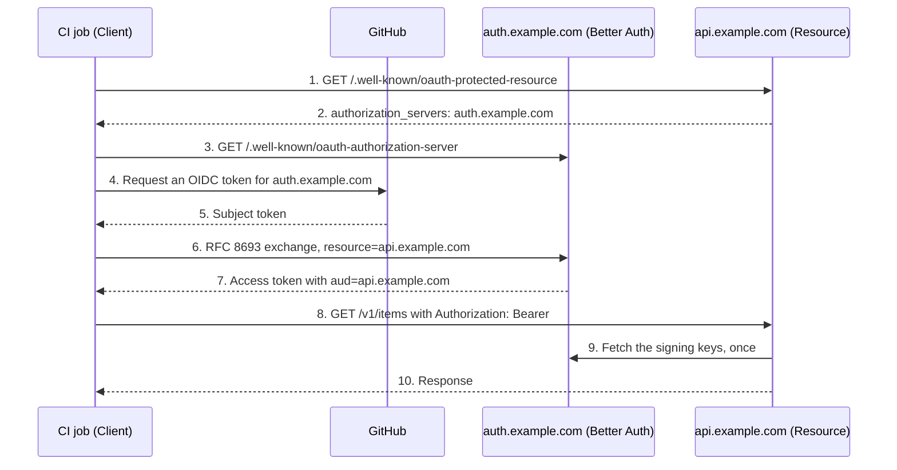

<h1 align="center">Handshakes</h1>

<p align="center">
  Short-lived OAuth tokens for workloads and CLIs, in place of stored API keys
</p>

<p align="center">
  <a href="#overview">Overview</a> · <a href="#agent-prompt">Agent Prompt</a> · <a href="#philosophy">Philosophy</a> · <a href="#features">Features</a> · <a href="#usage">Usage</a> · <a href="#cli">CLI</a> · <a href="#api">API</a>
</p>

## Overview

```ts
import Anthropic from '@anthropic-ai/sdk'
import { oidcFederationProvider } from '@anthropic-ai/sdk/lib/credentials/oidc-federation'
import { Identity } from 'handshakes'

// Requests a new OIDC token from the platform, such as GitHub Actions, for each exchange.
const identityTokenProvider = async () =>
  (await Identity.token({ audience: 'https://api.anthropic.com' })).value

// Exchanges the token for a short-lived Claude API token, in place of `ANTHROPIC_API_KEY`.
const client = new Anthropic({
  credentials: oidcFederationProvider({
    baseURL: 'https://api.anthropic.com',
    federationRuleId: 'fdrl_...',
    fetch,
    identityTokenProvider,
    organizationId: '00000000-0000-0000-0000-000000000000',
    serviceAccountId: 'svac_...',
  }),
})

const message = await client.messages.create({
  max_tokens: 1024,
  messages: [{ content: 'Summarize the release notes.', role: 'user' }],
  model: 'claude-opus-5-5',
})
```

## Agent Prompt

Paste this prompt into a coding agent:

```txt
Read github.com/wevm/handshakes and replace the stored API keys of my project with Handshakes.
```

## Philosophy

- **Short-lived:** Code stores no long-lived credential. An access token expires in minutes, and an exchanged token never outlives the subject token (the OIDC token of the platform) that it replaces.
- **Standard:** The client calls only standard OAuth endpoints, so it works with any authorization server that implements them, such as Better Auth or Google.
- **Universal:** One resolution order applies in CI, serverless functions, containers, and laptops.
- **Portable:** The core and server entries have no dependencies and no Node built-ins. They run in Node, Bun, Deno, and edge runtimes.
- **Explicit:** Every subject token has an explicit audience. A detected source that fails throws, and never falls through to a different identity.
- **Tested:** Every test runs against a real authorization server or a real platform, with no mocks.

## Features

- **Token Exchange:** Exchanges the OIDC token of GitHub Actions, Vercel, GitLab, CircleCI, Google Cloud, or Buildkite for an access token ([RFC 8693](https://www.rfc-editor.org/rfc/rfc8693)).
- **Device Authorization:** Runs the device authorization grant on a laptop ([RFC 8628](https://www.rfc-editor.org/rfc/rfc8628)), then stores and refreshes the grant.
- **Subject Tokens:** Returns the platform token itself, for APIs that accept it directly, such as Vercel AI Gateway, and for SDKs that exchange it, such as the Anthropic SDK.
- **Discovery:** Finds the authorization server of an API from its metadata ([RFC 9728](https://www.rfc-editor.org/rfc/rfc9728), [RFC 8414](https://www.rfc-editor.org/rfc/rfc8414)).
- **Grant Stores:** Keeps grants in memory, in a file with a lock across processes, or in the system keychain.
- **Token Endpoint:** Serves the RFC 8693 token endpoint as a fetch handler. The host issues the credential.
- **Token Verification:** Verifies the access tokens or platform tokens that an API receives, and returns the RFC 9728 `401` challenge.
- **Trust Policies:** Maps a subject token to scopes and a lifetime, and matches identifiers that cannot change, such as `repository_id`.
- **Better Auth Plugin:** Adds the token exchange to [`@better-auth/oauth-provider`](https://www.better-auth.com/docs/plugins/oauth-provider).
- **CLI and MCP:** Prints tokens, runs commands, and sends requests. No MCP tool returns a token value.
- **Test Issuer:** Signs real OIDC tokens and serves the platform endpoints, for tests without mocks.

## Usage

The examples below form one deployment of three parties. A CI job calls `api.example.com`, and `auth.example.com` issues its access tokens. The job stores no secret, and starts from the URL of the API only.



### `handshakes`

`Client` returns access tokens for one API. It resolves each token in this order:

1. A cached access token.
2. An exchange of the subject token of the detected platform.
3. A refresh of the stored grant.
4. A device grant, if stdin is a TTY and `CI` is not set.
5. Otherwise, `Client.AuthorizationRequiredError`.

`Client.discover` finds the authorization server from the API. `Client.create` takes the `issuer` directly, for an API without RFC 9728 metadata.

```ts
import { Client } from 'handshakes'

// Reads the RFC 9728 metadata of the API, then creates a client for its authorization server.
const client = await Client.discover({
  // OAuth client for the device grant and refresh. Required on a laptop only.
  clientId: 'example-cli',
  resource: 'https://api.example.com',
  scope: 'data:read',
})

// Sends the request with `Authorization: Bearer`. After a `401`, retries once with a new token.
const response = await client.fetch('https://api.example.com/v1/items')

// Revokes the refresh token and deletes the stored grant.
await client.revoke()
```

### `handshakes/node`

`handshakes/node` adds the sources and stores that use the file system or a child process.

```ts
import { Client } from 'handshakes'
import { NodeSource, Store } from 'handshakes/node'

const client = Client.create({
  clientId: 'example-cli',
  issuer: 'https://auth.example.com',
  // Adds Buildkite to the default sources.
  sources: NodeSource.defaults,
  // Writes the grant to `~/.config/handshakes/grants` with mode 0600, and refreshes under a lock.
  store: Store.file(),
})
```

### `handshakes/server`

`Resource` verifies the tokens that `api.example.com` receives. It serves the RFC 9728 metadata that names `auth.example.com`, and returns the `401` challenge.

```ts
import { Resource } from 'handshakes/server'

const resource = Resource.create({
  authorizationServers: ['https://auth.example.com'],
  resource: 'https://api.example.com',
})

export default {
  async fetch(request: Request) {
    // Names the authorization server, so clients discover it.
    if (new URL(request.url).pathname === '/.well-known/oauth-protected-resource')
      return resource.metadata()

    // Returns `401` with `WWW-Authenticate: Bearer resource_metadata="…"` for a bad token.
    const result = await resource.verify(request)
    if (result.status === 'invalid') return resource.challenge(result)

    return Response.json({ subject: result.principal.subject })
  },
}
```

An API can also run `Server` itself, with no separate authorization server. `Server` serves the RFC 8693 token endpoint and its RFC 8414 metadata as a fetch handler, and `issue` mints the credential of the host.

```ts
import { Policy, Server } from 'handshakes/server'

const server = Server.create({
  // Mints an API key. `context.expiresAt` already ends no later than the subject token.
  issue: async (context) => ({
    accessToken: await keys.mint({ expiresAt: context.expiresAt, scopes: context.policy.scopes }),
    expiresAt: context.expiresAt,
  }),
  issuer: 'https://api.example.com',
  // Accepts the GitHub Actions tokens of one repository on `main`.
  policies: [
    Policy.githubActions({
      audience: 'https://api.example.com',
      ref: 'refs/heads/main',
      repositoryId: '812345',
      scopes: ['data:read'],
    }),
  ],
})

// Serves `POST /oauth2/token` and `/.well-known/oauth-authorization-server`.
export default { fetch: server.fetch }
```

### `handshakes/better-auth`

`tokenExchange` adds the exchange to `auth.example.com`, a [Better Auth](https://www.better-auth.com) server with `@better-auth/oauth-provider`. Its access tokens are JWTs with the `aud` of the API, so `Resource` verifies them with the keys of `auth.example.com`.

```ts
import { oauthProvider } from '@better-auth/oauth-provider'
import { betterAuth } from 'better-auth'
import { jwt } from 'better-auth/plugins/jwt'
import { tokenExchange } from 'handshakes/better-auth'
import { Policy } from 'handshakes/server'

export const auth = betterAuth({
  baseURL: 'https://auth.example.com',
  plugins: [
    // Signs the access tokens, and serves the keys that `Resource` fetches.
    jwt(),
    oauthProvider({
      consentPage: '/consent',
      loginPage: '/login',
      // Issues JWT access tokens with the `aud` of the API (RFC 8707).
      resources: ['https://api.example.com'],
    }),
    // Caps every exchanged access token at 15 minutes.
    tokenExchange({ maxLifetime: 900 }),
  ],
})

// Stores the trust policy in the `trustPolicy` table.
await auth.api.createTrustPolicy({
  body: Policy.githubActions({
    audience: 'https://auth.example.com',
    clientId: 'ci',
    ref: 'refs/heads/main',
    repositoryId: '812345',
    scopes: ['data:read'],
  }),
})
```

### `handshakes/test`

`Issuer` signs real OIDC tokens for integration tests. It also serves the GitHub Actions token request, so `Source.githubActions` runs unchanged against it.

```ts
import { Identity } from 'handshakes'
import { Issuer } from 'handshakes/test'

const issuer = await Issuer.create()

// Returns the environment of a GitHub Actions job with `id-token: write`.
const env = await issuer.env({ preset: 'githubActions' })
const token = await Identity.token({ audience: 'https://auth.example.com', env })

await issuer.close()
```

## CLI

The `handshakes` CLI resolves an access token in the same order as `Client`. It writes the token or the response body to stdout, and prompts and messages to stderr.

```sh
# Runs the device grant and stores the grant.
handshakes authorize example

# Runs the tests with an access token in `EXAMPLE_API_KEY`.
handshakes exec example -- pnpm test

# Sends a request. Without a profile, discovers the authorization server from the API.
handshakes fetch https://api.example.com/v1/items --fail

# Prints the Vercel OIDC token for AI Gateway.
handshakes token --audience https://vercel.com/acme
```

### Commands

| Command                   | Behavior                                                             |
| ------------------------- | -------------------------------------------------------------------- |
| `authorize [profile]`     | Runs the device grant and stores the grant. Alias: `login`           |
| `exec [profile] -- <cmd>` | Runs `<cmd>` with an access token in an environment variable         |
| `fetch [profile] <url>`   | Sends a request with an access token                                 |
| `profiles`                | Lists the profiles and the file of each                              |
| `revoke [profile]`        | Revokes the refresh token and deletes the grant. Alias: `logout`     |
| `status [profile]`        | Prints the method, the subject, and the expiry. Never prints a token |
| `token [profile]`         | Prints an access token                                               |
| `token --audience <aud>`  | Prints the subject token for `<aud>`                                 |

### Options

| Option                       | Behavior                                                          |
| ---------------------------- | ----------------------------------------------------------------- |
| `--audience <aud>`           | Sets the audience of the subject token                            |
| `--client-id <id>`           | Sets the OAuth client for the device grant and refresh            |
| `--client-secret-env <NAME>` | Reads the client secret from this environment variable            |
| `--issuer <url>`             | Sets the authorization server. Overrides the profile              |
| `--json`                     | Prints machine-readable output                                    |
| `--mcp`                      | Serves `fetch` and `status` as MCP tools. No tool returns a token |
| `--no-interactive`           | Never runs the device grant. On when `CI` is set                  |
| `--resource <url>`           | Sets the RFC 8707 resource                                        |
| `--scope <scopes>`           | Sets the space-separated scopes                                   |
| `--source <name>`            | Uses only this source. Repeatable                                 |

### Profiles

The CLI reads `handshakes.json` in the nearest ancestor directory, then `~/.config/handshakes/config.json`. `HANDSHAKES_PROFILE` selects a profile, and `HANDSHAKES_CONFIG` names another file.

```json
{
  "default": "example",
  "profiles": {
    "example": {
      "clientId": "example-cli",
      "env": "EXAMPLE_API_KEY",
      "issuer": "https://auth.example.com",
      "scope": "data:read"
    }
  }
}
```

## API

### Modules

| Entry                    | Module          | Contents                                                                    |
| ------------------------ | --------------- | --------------------------------------------------------------------------- |
| `handshakes`             | `Client`        | `create` and `discover`. Returns access tokens through the resolution order |
|                          | `DeviceGrant`   | `start` and `wait` of the RFC 8628 device grant                             |
|                          | `Exchange`      | `request` of the RFC 8693 token exchange                                    |
|                          | `Identity`      | `token` and `detect`. Returns the subject token itself                      |
|                          | `Metadata`      | RFC 8414 and RFC 9728 metadata, and the `WWW-Authenticate` challenge        |
|                          | `Source`        | The platform sources, `defaults`, and `from`                                |
|                          | `Store`         | `memory` and `from`                                                         |
| `handshakes/node`        | `NodeSource`    | `buildkite`, `file`, and `defaults`                                         |
|                          | `Store`         | `file` and `keychain`                                                       |
| `handshakes/server`      | `Policy`        | `githubActions`, `vercel`, and `from`                                       |
|                          | `Resource`      | `create`, with `verify`, `metadata`, and `challenge`                        |
|                          | `Server`        | `create`, with the RFC 8693 token endpoint and its metadata                 |
| `handshakes/better-auth` | `tokenExchange` | The Better Auth plugin                                                      |
| `handshakes/test`        | `Issuer`        | `create`, with `sign`, `env`, and `close`                                   |

### Sources

`Source.defaults` holds the `Source` entries below, in priority order. `NodeSource.defaults` adds Buildkite.

| Source                   | Detects                       | Audience                                 |
| ------------------------ | ----------------------------- | ---------------------------------------- |
| `Source.vercel()`        | `VERCEL`, `VERCEL_OIDC_TOKEN` | Any                                      |
| `Source.githubActions()` | `GITHUB_ACTIONS`              | Any                                      |
| `Source.gitlab()`        | `GITLAB_CI`                   | Fixed in `id_tokens` of `.gitlab-ci.yml` |
| `Source.circleci()`      | `CIRCLECI`                    | Fixed                                    |
| `Source.gcp()`           | `K_SERVICE`                   | Any                                      |
| `NodeSource.buildkite()` | `BUILDKITE`                   | Any                                      |
| `NodeSource.file()`      | The file exists               | Fixed in the pod spec                    |
