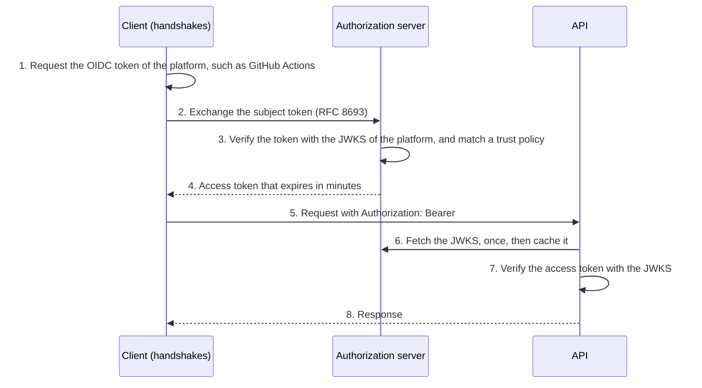
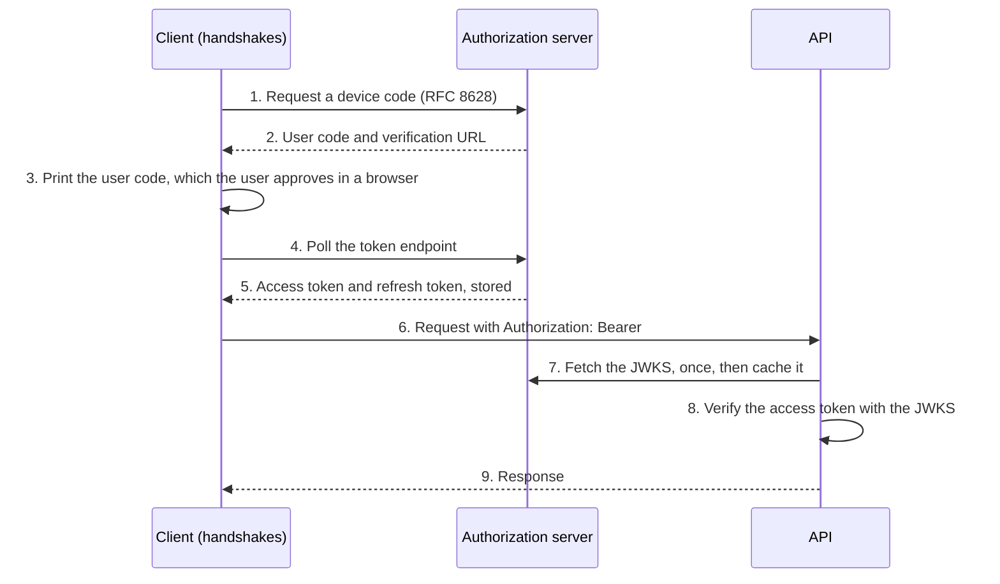

<h1 align="center">Handshakes</h1>

<p align="center">
  Short-lived OAuth tokens for workloads and CLIs, in place of stored API keys
</p>

<p align="center">
  <a href="#overview">Overview</a> · <a href="#agent-prompt">Agent Prompt</a> · <a href="#philosophy">Philosophy</a> · <a href="#features">Features</a> · <a href="#usage">Usage</a> · <a href="#cli">CLI</a>
</p>

## Overview

```ts
import { createOpenRouter } from '@openrouter/ai-sdk-provider'
import { generateText } from 'ai'
import { Client } from 'handshakes'

// Exchanges the OIDC token of the platform, such as GitHub Actions, at OpenRouter (RFC 8693).
const client = Client.create({
  endpoints: { token: 'https://openrouter.ai/api/v1/oauth/token' },
  // Names the federation policy, which maps the subject token to an OpenRouter API key.
  parameters: { federation_policy_id: '<policy id>' },
  // `aud` of the subject token. Equals the audience of the policy.
  subjectAudience: 'https://openrouter.ai',
})

// Expires in 15 minutes or less, and never after the subject token. Replaces `OPENROUTER_API_KEY`.
const token = await client.token()
const openrouter = createOpenRouter({ apiKey: token.value })

const { text } = await generateText({
  model: openrouter('anthropic/claude-sonnet-4.5'),
  prompt: 'Summarize the release notes.',
})
```

### Token Exchange

In CI and on servers, the client exchanges the OIDC token of the platform for an access token. In the example above, OpenRouter is both the authorization server and the API.



### Device Grant

On a device (such as a laptop), the client runs the device grant once and stores the grant. After that, it refreshes the grant before the access token expires.



## Agent Prompt

Paste this prompt into a coding agent:

```txt
Read github.com/wevm/handshakes and replace the stored API keys of my project with Handshakes.
```

## Philosophy

- **Short-lived:** Code stores no long-lived credential. An access token expires in minutes, and an exchanged token never outlives the subject token (the OIDC token of the platform) that it replaces.
- **Standard:** The client calls only standard OAuth endpoints, so it works with any authorization server that implements them, such as Better Auth or Google.
- **Universal:** One resolution order applies in CI, serverless functions, containers, and devices.
- **Portable:** The core and server entries have no dependencies and no Node built-ins. They run in Node, Bun, Deno, and edge runtimes.
- **Explicit:** Every subject token has an explicit audience. A detected source that fails throws, and never falls through to a different identity.
- **Tested:** Every test runs against a real authorization server or a real platform, with no mocks.

## Features

- **Token Exchange:** Exchanges the OIDC token of GitHub Actions, Vercel, GitLab, CircleCI, Azure, Google Cloud, or Buildkite for an access token ([RFC 8693](https://www.rfc-editor.org/rfc/rfc8693)).
- **Device Authorization:** Runs the device authorization grant on a device ([RFC 8628](https://www.rfc-editor.org/rfc/rfc8628)), then stores and refreshes the grant.
- **Subject Tokens:** Returns the platform token itself, for APIs that accept it directly, such as Vercel AI Gateway.
- **Discovery:** Finds the authorization server of an API from its metadata ([RFC 9728](https://www.rfc-editor.org/rfc/rfc9728), [RFC 8414](https://www.rfc-editor.org/rfc/rfc8414)).
- **Grant Stores:** Keeps grants in memory, in a file with a lock across processes, or in the system keychain.
- **Token Endpoint:** Serves the RFC 8693 token endpoint as a fetch handler. The host issues the credential.
- **Token Verification:** Verifies the access tokens or platform tokens that an API receives, and returns the RFC 9728 `401` challenge.
- **Trust Policies:** Maps a subject token to scopes and a lifetime, and matches identifiers that cannot change, such as `repository_id`.
- **Better Auth Plugin:** Adds the token exchange to [`@better-auth/oauth-provider`](https://www.better-auth.com/docs/plugins/oauth-provider).
- **CLI and MCP:** Prints tokens, runs commands, and sends requests. No MCP tool returns a token value.
- **Test Issuer:** Signs real OIDC tokens and serves the platform endpoints, for tests without mocks.

## Usage

The examples below use `auth.example.com` as the authorization server, and `api.example.com` as the API.

### Client

`Client` returns an access token for one API. In CI, it exchanges the OIDC token of the platform. On a device, it runs the device grant and refreshes the stored grant.

```ts
import { Client } from 'handshakes'
import { Store } from 'handshakes/node'

const client = Client.create({
  // OAuth client for the device grant. Required on a device only.
  clientId: 'example-cli',
  issuer: 'https://auth.example.com',
  scope: 'data:read',
  // Keeps the grant in `~/.config/handshakes/grants`, shared by every process.
  store: Store.file(),
})

// Sends the request with `Authorization: Bearer`.
const response = await client.fetch('https://api.example.com/v1/items')
```

### Authorization Server

`Server` serves the token exchange (RFC 8693) as a fetch handler. It verifies the subject token, matches a trust policy, and calls `issue` for the credential.

```ts
import { Policy, Server } from 'handshakes/server'

const server = Server.create({
  // Mints the credential, such as an API key. It expires no later than the subject token.
  issue: async (context) => ({
    accessToken: await keys.mint({ expiresAt: context.expiresAt, scopes: context.policy.scopes }),
    expiresAt: context.expiresAt,
  }),
  issuer: 'https://auth.example.com',
  // Accepts the GitHub Actions tokens of one repository.
  policies: [
    Policy.githubActions({
      audience: 'https://auth.example.com',
      repositoryId: '812345',
      scopes: ['data:read'],
    }),
  ],
})

// Serves `POST /oauth2/token` and `/.well-known/oauth-authorization-server`.
export default { fetch: server.fetch }
```

On a [Better Auth](https://www.better-auth.com) server, `tokenExchange` adds the same exchange to `@better-auth/oauth-provider`, and Better Auth issues the access tokens.

```ts
import { oauthProvider } from '@better-auth/oauth-provider'
import { betterAuth } from 'better-auth'
import { jwt } from 'better-auth/plugins/jwt'
import { tokenExchange } from 'handshakes/better-auth'

export const auth = betterAuth({
  plugins: [
    jwt(),
    oauthProvider({
      consentPage: '/consent',
      loginPage: '/login',
      // Issues JWT access tokens with the `aud` of the API (RFC 8707).
      resources: ['https://api.example.com'],
    }),
    // Adds the token exchange. Trust policies live in the `trustPolicy` table.
    tokenExchange(),
  ],
})
```

### API

`Resource` verifies the access tokens that the API receives, and returns the `401` challenge. If `Server` issues an API key instead, the API checks that key as before.

```ts
import { Resource } from 'handshakes/server'

const resource = Resource.create({
  authorizationServers: ['https://auth.example.com'],
  resource: 'https://api.example.com',
})

export default {
  async fetch(request: Request) {
    // Returns `401` with `WWW-Authenticate` for a missing or invalid token.
    const result = await resource.verify(request)
    if (result.status === 'invalid') return resource.challenge(result)

    return Response.json({ subject: result.principal.subject })
  },
}
```

### Testing

`Issuer` from `handshakes/test` signs real OIDC tokens for integration tests. It also serves the GitHub Actions token request, so `Source.githubActions` runs unchanged against it.

```ts
import { Identity } from 'handshakes'
import { Issuer } from 'handshakes/test'

const issuer = await Issuer.create()

// Returns the environment of a GitHub Actions job with `id-token: write`.
const env = await issuer.env({ preset: 'githubActions' })
const token = await Identity.token({ audience: 'https://auth.example.com', env })

await issuer.close()
```

## CLI

The `handshakes` CLI resolves an access token in the same order as `Client`. A profile names the authorization server and the client. The CLI reads profiles from `handshakes.json` in the nearest ancestor directory, then from `~/.config/handshakes/config.json`.

```json
{
  "default": "example",
  "profiles": {
    "example": {
      "clientId": "example-cli",
      "env": "EXAMPLE_API_KEY",
      "issuer": "https://auth.example.com",
      "scope": "data:read"
    },
    "gcp": {
      "endpoints": { "token": "https://sts.googleapis.com/v1/token" },
      "scope": "https://www.googleapis.com/auth/cloud-platform",
      "sources": {
        "githubActions": {
          "parameters": {
            "audience": "//iam.googleapis.com/projects/<number>/locations/global/workloadIdentityPools/<pool>/providers/github"
          },
          "subjectAudience": "https://iam.googleapis.com/projects/<number>/locations/global/workloadIdentityPools/<pool>/providers/github"
        }
      }
    },
    "openrouter": {
      "endpoints": { "token": "https://openrouter.ai/api/v1/oauth/token" },
      "env": "OPENROUTER_API_KEY",
      "parameters": { "federation_policy_id": "<policy id>" },
      "subjectAudience": "https://openrouter.ai"
    }
  }
}
```

The settings of a profile are options of `Client.create`, except `env`, the variable of `exec`. `sources` holds `parameters` and `subjectAudience` for one source, the JSON form of `Client.PerSource`. An unknown setting fails, so no setting is dropped silently.

```sh
# Runs the device grant and stores the grant.
handshakes authorize example

# Reads the client secret from a variable, for a server such as Google. The CLI reads no secret from argv.
handshakes authorize example --client-secret-env EXAMPLE_CLIENT_SECRET

# Runs the tests with an access token in `EXAMPLE_API_KEY`.
handshakes exec example -- pnpm test

# Exchanges only the OIDC token of GitHub Actions, and never runs the device grant.
handshakes token openrouter --source githubActions --no-interactive
```

```txt
$ handshakes --help
handshakes@0.0.0 — Resolves short-lived OAuth access tokens from the platform identity or a stored grant, in place of stored API keys.

Usage: handshakes <command>

Commands:
  authorize  Runs the device grant (RFC 8628) and stores the grant.
  exec       Runs the command after `--` with an access token in an environment variable, then exits with its code.
  fetch      Sends a request with an access token, and prints the response body. Without a profile, discovers the authorization server from the API.
  login      Runs the device grant (RFC 8628) and stores the grant. Alias of authorize.
  logout     Revokes the refresh token (RFC 7009) and deletes the stored grant. Alias of revoke.
  profiles   Lists the profiles, the file of each, and the default profile.
  revoke     Revokes the refresh token (RFC 7009) and deletes the stored grant.
  status     Names the source that detects its platform here and, for a profile, the stored grant and its expiry.
  token      Prints the access token of a profile. With --audience, prints the OIDC token that the platform signs for this code.

Integrations:
  completions  Generate shell completion script
  mcp          Register as MCP server (add, doctor)
  skills       Sync skill files to agents (add, list)

Global Options:
  --filter-output <keys>              Filter output by key paths (e.g. foo,bar.baz,a[0,3])
  --format <toon|json|yaml|md|jsonl>  Output format
  --full-output                       Show full output envelope
  --help                              Show help
  --llms, --llms-full                 Print LLM-readable manifest
  --mcp                               Start as MCP stdio server
  --schema                            Show JSON Schema for command
  --token-count                       Print token count of output (instead of output)
  --token-limit <n>                   Limit output to n tokens
  --token-offset <n>                  Skip first n tokens of output
  --update                            Update to latest version
  --version                           Show version
```

### Exit Codes

| Code  | Meaning                                                                          |
| ----- | -------------------------------------------------------------------------------- |
| 0     | Success                                                                          |
| 1     | Unexpected error                                                                 |
| 2     | Invalid usage, such as an unknown profile, an unknown source, or an unset secret |
| 3     | Authorization required: no source, no grant, and not interactive                 |
| 4     | The server rejected the subject token with `invalid_grant`                       |
| 22    | `fetch --fail` received HTTP 400 or more. The output still holds the response    |
| Other | `exec` returns the exit code of the child                                        |

If the server rejects the refresh token of a grant, the CLI deletes the grant. It then runs the device grant, or exits with 3 when it is not interactive.

## License

[MIT](LICENSE)
