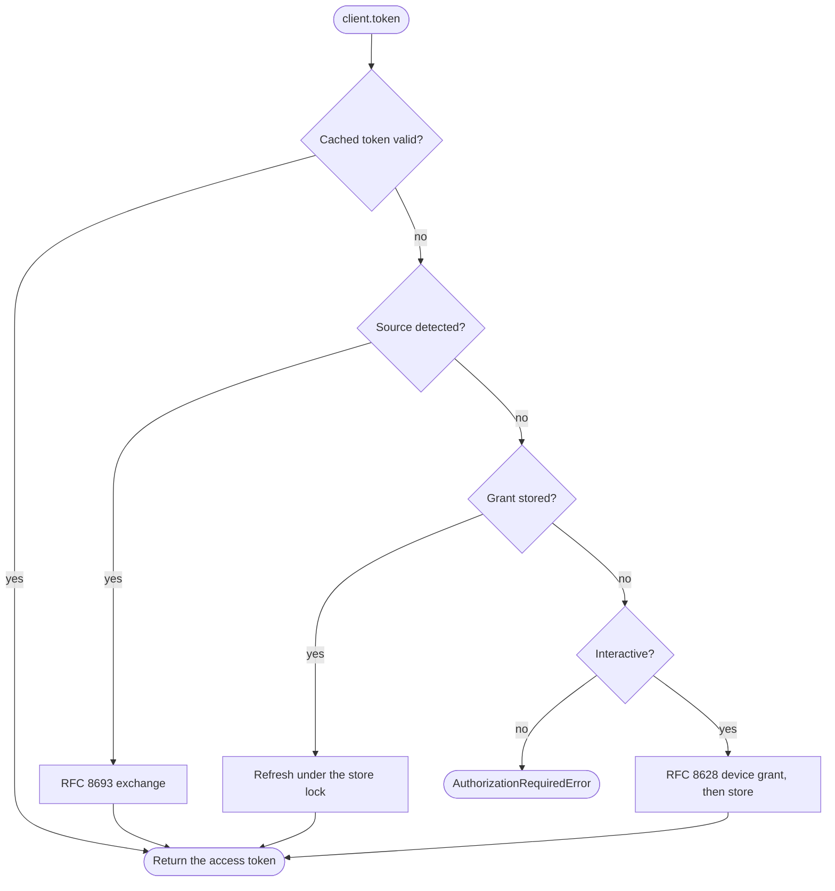

# Client.create [Returns a client for one API]

The client resolves an access token in a fixed order, caches it, and attaches it to requests. Creating the client sends no request. The first call to `token` or `fetch` reads the metadata of the issuer, once.

```ts [example.ts]
import { Client } from 'handshakes'
import { Store } from 'handshakes/node'

const client = Client.create({
  // OAuth client for the device grant. Required on a device only.
  clientId: 'example-cli',
  issuer: 'https://auth.example.com',
  scope: 'data:read',
  // Keeps the grant in a file that every process of the user shares
  store: Store.file(),
})

// Sends the request with `Authorization: Bearer`
const response = await client.fetch('https://api.example.com/v1/items')
```

## Signature

```ts
// A client for one authorization server and one resource
Client.create(options)
```

`create` throws a `TypeError` when neither `issuer` nor `endpoints` is set.

## Parameters

### options.clientId

- **Type:** `string`
- **Default:** `undefined`

The OAuth client for the device grant and for refresh. `authorize` throws a `TypeError` without it, and a stored grant does not refresh without it. An exchange sends it as `client_id` when it is set.

```ts
// Registers the CLI as the client of the device grant
Client.create({ clientId: 'example-cli', issuer: 'https://auth.example.com' })
```

### options.clientSecret

- **Type:** `string`
- **Default:** `undefined`

The client secret, for servers that require one, such as Google. The client sends it with the device grant, the refresh, the revocation, and the exchange. Read it from an environment variable, never from a command-line argument.

```ts
// Reads the secret from the environment of the process
Client.create({
  clientId: 'example-cli',
  clientSecret: process.env['EXAMPLE_CLIENT_SECRET'],
  issuer: 'https://auth.example.com',
})
```

### options.endpoints

- **Type:** `Metadata.Endpoints`
- **Default:** `undefined`

Explicit endpoints, for servers without RFC 8414 metadata. The client then reads no metadata. `token` is required. `deviceAuthorization` enables `authorize`, and `revocation` enables the revocation request of `revoke`.

```ts
// Exchanges at a token endpoint that serves no metadata
Client.create({
  endpoints: { token: 'https://openrouter.ai/api/v1/oauth/token' },
  subjectAudience: 'https://openrouter.ai',
})
```

Without `issuer`, the token endpoint takes the place of the issuer in the store key and in errors.

### options.env

- **Type:** `Source.Env`
- **Default:** `process.env` where the runtime has one, else an empty environment

The environment that sources read. The default of `interactive` also reads `CI` from it. Tests pass the environment of the [test issuer](/api/test/issuer/create) here.

```ts
// Detects the platform from an explicit environment
Client.create({ env: { GITHUB_ACTIONS: 'true' }, issuer: 'https://auth.example.com' })
```

### options.fetch

- **Type:** `typeof globalThis.fetch`
- **Default:** `globalThis.fetch`

The function that sends every request: metadata, subject tokens, exchanges, refreshes, revocations, and the requests of `client.fetch`.

```ts
// Sends every request through a function that logs the URL
Client.create({
  fetch: (input, init) => {
    console.error('request', String(input instanceof Request ? input.url : input))
    return globalThis.fetch(input, init)
  },
  issuer: 'https://auth.example.com',
})
```

### options.interactive

- **Type:** `boolean`
- **Default:** `true` when stdin is a TTY and `CI` is not set, else `false`

Whether `token` runs the device grant when no source detects and no stored grant applies. Without it, `token` throws `Client.AuthorizationRequiredError`. `status` reports `false` unless this option is set.

```ts
// Never prompts, also in a terminal
Client.create({ interactive: false, issuer: 'https://auth.example.com' })
```

### options.issuer

- **Type:** `string`
- **Default:** `undefined`

The authorization server. The client reads its RFC 8414 metadata, then its OpenID Connect Discovery document, and uses the endpoints that they name. The `issuer` of the metadata must equal this value exactly (RFC 8414 §3.3). It is also the default `aud` of the subject token. Required unless `endpoints` is set.

```ts
// Reads the endpoints from https://auth.example.com/.well-known/oauth-authorization-server
Client.create({ issuer: 'https://auth.example.com' })
```

### options.onDeviceCode

- **Type:** `(code: DeviceGrant.Code) => void`
- **Default:** prints `Open <verification URI> and confirm <user code>.` to stderr

Receives the user code and the verification page during `authorize`. The default prints `verificationUriComplete` when the server returns one, else `verificationUri`.

```ts
// Shows the code in the interface of the program
Client.create({
  clientId: 'example-cli',
  issuer: 'https://auth.example.com',
  onDeviceCode: (code) => console.log(code.verificationUri, code.userCode),
})
```

### options.parameters

- **Type:** `Client.PerSource<Readonly<Record<string, string>>>`
- **Default:** `undefined`

Extra fields of the token exchange, such as the `federation_policy_id` of OpenRouter. They cannot replace `grant_type`, `subject_token`, or `subject_token_type`. A function receives the detected source, so each platform can send other fields.

```ts
// Names the federation policy of OpenRouter in each exchange
Client.create({
  endpoints: { token: 'https://openrouter.ai/api/v1/oauth/token' },
  parameters: { federation_policy_id: '<policy id>' },
  subjectAudience: 'https://openrouter.ai',
})
```

### options.resource

- **Type:** `string`
- **Default:** `undefined`

The RFC 8707 resource of the access token, such as the API. The client sends it with the device grant and the exchange. It also keys the stored grant, so a grant for another resource is never used. `client.fetch` sends the token only to URLs within the resource.

```ts
// Requests a token for one API, and sends it to that API only
Client.create({ issuer: 'https://auth.example.com', resource: 'https://api.example.com' })
```

### options.scope

- **Type:** `string`
- **Default:** `undefined`

Space-separated scopes. The client sends them with the device grant and the exchange.

```ts
// Requests read access only
Client.create({ issuer: 'https://auth.example.com', scope: 'data:read' })
```

### options.sources

- **Type:** `readonly Source.Source[]`
- **Default:** [`Source.defaults`](/api/core/source)

The sources of subject tokens, in priority order. The first source whose `detect` returns `true` supplies the subject token. [`Source.defaults`](/api/node) of `handshakes/node` adds Buildkite.

```ts
import { Client, Source } from 'handshakes'

// Exchanges only the token of GitHub Actions
Client.create({ issuer: 'https://auth.example.com', sources: [Source.githubActions()] })
```

### options.store

- **Type:** `Store.Store`
- **Default:** `Store.memory()`

Where grants persist. The memory store serves one process. On a device, [`Store.file`](/api/node/store/file) keeps the grant across processes, and locks each refresh for all of them.

```ts
import { Client } from 'handshakes'
import { Store } from 'handshakes/node'

// Shares the grant with every process of the user
Client.create({ clientId: 'example-cli', issuer: 'https://auth.example.com', store: Store.file() })
```

### options.subjectAudience

- **Type:** `Client.PerSource<string>`
- **Default:** `issuer`

The `aud` of the subject token. Set it when the authorization server expects another audience than its issuer. Without it and without `issuer`, the exchange throws a `TypeError`.

```ts
// Requests a subject token for the audience of the OpenRouter policy
Client.create({
  endpoints: { token: 'https://openrouter.ai/api/v1/oauth/token' },
  subjectAudience: 'https://openrouter.ai',
})
```

## Returns

The client, a plain object. Its functions close over the options and need no binding.

### authorize

- **Type:** `(options?: { signal?: AbortSignal }) => Promise<Grant.Grant>`

Runs the device grant ([RFC 8628](https://www.rfc-editor.org/rfc/rfc8628)), stores the grant, and caches its access token. It calls `onDeviceCode` with the user code, then polls the token endpoint until approval. `signal` stops the polling.

```ts
// Runs the device grant once, then stores the grant
const grant = await client.authorize()
```

### fetch

- **Type:** `(input: RequestInfo | URL, init?: RequestInit) => Promise<Response>`

Sends the request with `Authorization: Bearer`. After a `401`, it removes the cached token and sends the request once more with a new token. It returns a redirect response unfollowed, so a redirect never carries the token to another host. With `resource`, a URL outside the resource throws `Client.ResourceError` before any request.

```ts
// Retries once with a new token if the API returns 401
const response = await client.fetch('https://api.example.com/v1/items', { method: 'GET' })
```

A URL is within the resource when it has the origin of the resource, and a path at or below the path of the resource.

### invalidate

- **Type:** `() => void`

Removes the cached access token. The next call to `token` resolves a new one. The stored grant stays.

```ts
// Forces a new exchange or refresh on the next request
client.invalidate()
```

### revoke

- **Type:** `() => Promise<void>`

Removes the cached token, and deletes the stored grant. Then it revokes the refresh token at the revocation endpoint ([RFC 7009](https://www.rfc-editor.org/rfc/rfc7009)), when the grant has a refresh token and the server has the endpoint. A `4xx` response counts as revoked, since some servers return `400` for a token that they no longer know. A `5xx` response throws `Client.RejectedError`.

```ts
// Signs the device out
await client.revoke()
```

### status

- **Type:** `() => Promise<Client.Status>`

Returns the method that applies, with its source or subject, and its expiry. It sends no request, and never includes a token value.

```ts
// Logs the method without a token value
console.log(await client.status())
```

### token

- **Type:** `() => Promise<Client.AccessToken>`

Returns the cached access token, or resolves a new one through the resolution order. Concurrent calls share one request in flight.

```ts
// Reads the token for a library that takes an API key
const token = await client.token()
```

## Resolution Order

`token` tries each method in order, and stops at the first that applies.



1. **Cache:** A cached token applies until 60 seconds or 20% of its lifetime remain, whichever is more.
2. **Exchange:** The first source that detects its platform supplies the subject token, and the client exchanges it ([RFC 8693 §2.1](https://www.rfc-editor.org/rfc/rfc8693#section-2.1)). The access token expires no later than the subject token. A detected source that fails throws, and the client tries no other method, since another method can select a different identity.
3. **Stored grant:** A stored grant for the same resource applies with the same margin as the cache. After that, the client refreshes it ([RFC 6749 §6](https://www.rfc-editor.org/rfc/rfc6749#section-6)) under the lock of the store, and reads the grant again inside the lock. So only one process uses a refresh token. A grant without a refresh token, or a client without `clientId`, skips the refresh. An `invalid_grant` response deletes the grant. In both cases, the client continues with step 4.
4. **Device grant:** If the client is interactive, it runs `authorize`. Otherwise, it throws `Client.AuthorizationRequiredError`.

## Errors

- **`Client.AuthorizationRequiredError`:** No source detects, no grant applies, and the client is not interactive.
- **`Client.RejectedError`:** The token endpoint rejects a refresh with an error other than `invalid_grant`, or the revocation endpoint returns a `5xx` status.
- **`Client.ResourceError`:** `fetch` receives a URL outside `resource`.
- **`DeviceGrant.DeniedError`:** The user denies the code during `authorize`.
- **`DeviceGrant.ExpiredError`:** The code expires before approval.
- **`DeviceGrant.RejectedError`:** The device authorization or token endpoint returns another RFC 6749 §5.2 error.
- **`DeviceGrant.UnsupportedError`:** The server has no device authorization endpoint.
- **`Exchange.RejectedError`:** The token endpoint rejects the exchange, such as with `invalid_grant` when no trust policy matches.
- **`Grant.InvalidResponseError`:** A refresh or device grant response has no `access_token` or `expires_in`.
- **`Identity.AudienceError`:** The token of a source with a fixed audience carries another `aud`.
- **`Metadata.NotFoundError`:** The issuer serves no valid metadata.
- **`Source.RequestError`:** The detected source cannot return a token, such as a GitHub Actions job without `id-token: write`.
- **`Store.LockTimeoutError`:** From [`Store.file`](/api/node/store/file). Another process holds the lock of the grant past `lockTimeout`.

[Errors](/api/core/errors) lists the fields of each error.

```ts
import { Client } from 'handshakes'

const client = Client.create({ issuer: 'https://auth.example.com', interactive: false })

await client.token().catch((error: unknown) => {
  // Prints the steps, such as running `handshakes authorize`
  if (error instanceof Client.AuthorizationRequiredError) console.error(error.message)
  else throw error
})
```

## Types

### Client.AccessToken

An access token and the method that returned it.

```ts
// The result of client.token()
type AccessToken = {
  /** When the token expires, in milliseconds since the epoch. */
  expiresAt: number
  /** `exchange`: from a subject token. `grant`: from a stored or new grant. */
  method: 'exchange' | 'grant'
  /** Space-separated scopes, when the server returns them. */
  scope?: string | undefined
  /** The authorization scheme of the token. */
  type: 'Bearer'
  /** The token. */
  value: string
}
```

### Client.Status

The method that applies for a client. It never holds a token value.

```ts
// The result of client.status()
type Status =
  | {
      /** When the cached access token expires, when one is cached. */
      expiresAt?: number | undefined
      method: 'exchange'
      /** Name of the detected source, such as `githubActions`. */
      source: string
    }
  | {
      /** When the access token of the stored grant expires. */
      expiresAt: number
      method: 'grant'
      /** Whether the grant has a refresh token. */
      refreshable: boolean
      /** `sub` of the access token, when it is a JWT. */
      subject?: string | undefined
    }
  | {
      /** Names of the sources that were checked. */
      checked: readonly string[]
      /** Whether the client runs the device grant when a token is requested. */
      interactive: boolean
      method: 'none'
    }
```

### Client.PerSource

A value, or a function of the detected source. `parameters` and `subjectAudience` take this type, such as a different `audience` field for each provider of Google STS. A function returns `undefined` for a source that takes the default.

```ts
import { Client } from 'handshakes'

// Sends a different provider audience for each platform
const audience: Client.PerSource<Readonly<Record<string, string>>> = (source) => ({
  audience: `//iam.googleapis.com/projects/123/locations/global/workloadIdentityPools/ci/providers/${source.name}`,
})
```
