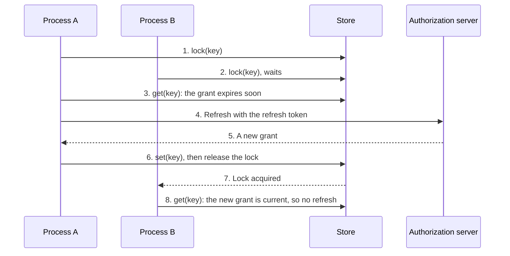

# Store [Persistence of grants, with a lock that serializes refreshes]

A store keeps the [grants](/api/core/grant) that the device grant issues, so a client refreshes a grant instead of running the device grant again. [`Client.create`](/api/core/client/create) reads and writes grants through its `store`, under the key of [`Grant.key`](/api/core/grant).

```ts [example.ts]
import { Client, Store } from 'handshakes'

const client = Client.create({
  clientId: 'example-cli',
  issuer: 'https://auth.example.com',
  // [!code hl:2]
  // Keeps grants in memory, for this process only
  store: Store.memory(),
})
```

| Store            | Entry             | Behavior                                                                              |
| ---------------- | ----------------- | ------------------------------------------------------------------------------------- |
| `Store.memory()` | `handshakes`      | One process only. The default of `Client.create`                                      |
| `Store.from()`   | `handshakes`      | Types a custom store                                                                  |
| `Store.file()`   | `handshakes/node` | Files with mode 0600, atomic writes, and a lock that covers every process of the user |

[`Store.file`](/api/node/store/file) of `handshakes/node` is the store for a device, such as a laptop, where several processes share one grant.

:::note
`Store.keychain` of `handshakes/node` is not implemented. The macOS `security` command reads the secret from argv or a prompt, and other processes of the system can read argv.
:::

## Store.memory

- **Type:** `() => Store.Store`

Returns a store that keeps grants in a `Map`, for one process. Its lock queues the calls for a key: each call waits for the previous one, whether that one resolved or rejected. The grants are gone when the process exits.

```ts
import { Store } from 'handshakes'

// A store for one test, or for one serverless instance
const store = Store.memory()
```

## Store.from

- **Type:** `(store: Store.Store) => Store.Store`

Returns `store` unchanged, typed as a store. A custom store keeps grants in another place, such as a database. Its `lock` must exclude every process that shares the grants.

```ts
import { Grant, Store } from 'handshakes'

// A key-value database of the host, with a lock that covers every process
type Database = {
  delete: (key: string) => Promise<void>
  get: (key: string) => Promise<string | undefined>
  set: (key: string, value: string) => Promise<void>
  withLock: <result>(key: string, fn: () => Promise<result>) => Promise<result>
}

declare const database: Database

const store = Store.from({
  delete: (key) => database.delete(key),
  async get(key) {
    const value = await database.get(key)
    return value === undefined ? undefined : Grant.from(JSON.parse(value))
  },
  // [!code hl:2]
  // Serializes the refreshes of one grant across every process
  lock: (key, fn) => database.withLock(key, fn),
  set: (key, grant) => database.set(key, JSON.stringify(grant)),
})
```

A grant holds token values. Keep it where only the user or the service can read it, and never log it.

## Lock Contract

A refresh token can rotate. A server such as Better Auth revokes every refresh token of the client and user when a refresh token is used twice. So two processes that refresh one grant at the same time can revoke the grant for both.

`Client.create` refreshes a grant inside `lock`, and reads the grant again inside it. If another process refreshed the grant first, the client uses that grant and sends no refresh.



## Types

```ts
// The shape of every store
type Store = {
  /** Removes the grant. */
  delete: (key: string) => Promise<void>
  /** Returns the grant, if one is stored. */
  get: (key: string) => Promise<Grant.Grant | undefined>
  /** Runs `fn` under a lock for `key`. */
  lock: <result>(key: string, fn: () => Promise<result>) => Promise<result>
  /** Writes the grant. */
  set: (key: string, grant: Grant.Grant) => Promise<void>
}
```

- **`Store.Store`:** A store.

## Errors

The stores of the core entry throw no error of their own. `Store.file` of `handshakes/node` throws `Store.LockTimeoutError` when another process holds the lock past `lockTimeout`.
