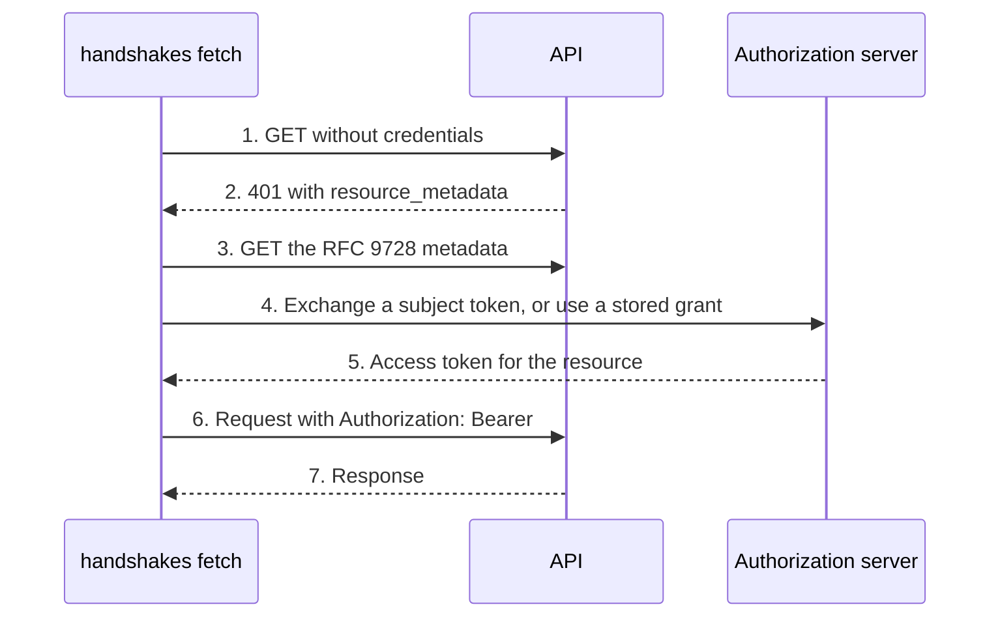

# fetch [Sends a request with an access token and prints the response body]

`handshakes fetch` resolves an access token, sends one HTTP request with `Authorization: Bearer`, and prints the response body. Without a profile, it discovers the authorization server from the RFC 9728 metadata of the API. An [MCP](/cli/mcp) agent calls the same command as a tool.

```sh
# Sends GET with an access token for the resource of the example profile
handshakes fetch example https://api.example.com/v1/items
```

The examples on this page use a profile whose `resource` is the API:

```json [handshakes.json]
{
  "profiles": {
    "example": {
      "clientId": "example-cli",
      "issuer": "https://auth.example.com",
      "resource": "https://api.example.com",
      "scope": "data:read"
    }
  }
}
```

## Signature

```sh
# With a profile, or with the URL alone
handshakes fetch [profile] <url> [options]
handshakes fetch <url> [options]
```

With one argument, the argument is the URL. The CLI still selects `HANDSHAKES_PROFILE` or the `default` profile, if one applies. Discovery runs only when no profile applies and `--issuer` is not set.

## Arguments

### profile

- **Type:** `string`
- **Default:** `HANDSHAKES_PROFILE`, else the `default` profile

The name of a profile of the [configuration](/cli/configuration). With one argument, this position holds the URL.

```sh
# Uses the example profile, whose resource is https://api.example.com
handshakes fetch example https://api.example.com/v1/items
```

### url

- **Type:** `string`

The URL of the request. The CLI checks it against the profile before it sends a token. See [Token Scope](#token-scope).

```sh
# Discovers the authorization server of the API, then sends the request
handshakes fetch https://api.example.com/v1/items
```

## Options

### --method, -X

- **Type:** `string`
- **Default:** `GET`, or `POST` with `--data`

The HTTP method of the request.

```sh
# Sends DELETE
handshakes fetch example https://api.example.com/v1/items/42 -X DELETE
```

### --header, -H

- **Type:** `readonly string[]`

A request header, written as `Name: value`. Repeat the option for several headers. The CLI sets `Authorization` itself, so a header of that name is replaced.

```sh
# Sends a JSON body with its content type
handshakes fetch example https://api.example.com/v1/items -H 'Content-Type: application/json' -d '{"name":"a"}'
```

### --data, -d

- **Type:** `string`

The request body. A value that starts with `@` names a file, and the CLI sends the content of that file. An MCP agent cannot read a file this way.

```sh
# Sends the content of item.json as the body
handshakes fetch example https://api.example.com/v1/items -H 'Content-Type: application/json' -d @item.json
```

### --include, -i

- **Type:** `boolean`
- **Default:** `false`

Prints the status line and the response headers, then an empty line, before the body.

```sh
# Prints HTTP 200 OK and the headers before the body
handshakes fetch example https://api.example.com/v1/items -i
```

### --fail

- **Type:** `boolean`
- **Default:** `false`

Exits with code 22 when the response status is 400 or more, as `curl --fail` does. The body still prints.

```sh
# Stops a script when the API returns an error
handshakes fetch example https://api.example.com/v1/items --fail || exit 1
```

### --client-id

- **Type:** `string`
- **Default:** `clientId` of the profile

The OAuth client for the device grant and refresh. It also applies to discovery.

```sh
# Discovers the server, and uses this client for the device grant
handshakes fetch https://api.example.com/v1/items --client-id example-cli
```

### --issuer

- **Type:** `string`
- **Default:** `issuer` of the profile

The authorization server. With `--issuer`, a profile applies, so no discovery runs.

```sh
# Skips discovery, and sends the token only to the origin of the issuer
handshakes fetch https://auth.example.com/v1/items --issuer https://auth.example.com
```

### --resource

- **Type:** `string`
- **Default:** `resource` of the profile

The RFC 8707 resource of the access token. The CLI then sends the token to URLs at or below the resource.

```sh
# Requests a token for version 2 of the API only
handshakes fetch example https://api.example.com/v2/items --resource https://api.example.com/v2
```

### --scope

- **Type:** `string`
- **Default:** `scope` of the profile

The space-separated scopes of the access token. It also applies to discovery.

```sh
# Requests a token that can write
handshakes fetch example https://api.example.com/v1/items -X POST -d '{}' --scope data:write
```

## Token Scope

The CLI sends a token only to the API that the token is for:

- **With a resource:** The URL must have the origin of the resource, and a path at or below its path.
- **Without a resource:** The URL must have the origin of the issuer, or of the token endpoint.
- **With discovery:** The URL must lie within the `resource` of the metadata of the API. The token is then for that resource.

A URL outside these limits exits with code 2 and `OUTSIDE_RESOURCE`. The CLI sends no request in that case.

## Behavior

- **Retry:** After a `401` response, the CLI requests a new token and sends the request once more.
- **Redirects:** The CLI returns a redirect response unfollowed, so the token never follows a redirect to another host.
- **Discovery:** The CLI sends one `GET` without credentials, and reads `resource_metadata` from the `WWW-Authenticate` challenge. It then uses the first authorization server of the metadata.



## Output

Without `--format`, the CLI prints the response body as it is. With `--format`, such as `--json`, the CLI prints these fields:

- **`body`:** The response body as text.
- **`headers`:** The response headers, as an object.
- **`status`:** The HTTP status of the response.

```sh
# Prints the status of the response alone
handshakes fetch example https://api.example.com/v1/items --json --filter-output status
```

## Errors

| Error code               | Exit code | Condition                                                                                   |
| ------------------------ | --------- | ------------------------------------------------------------------------------------------- |
| `NO_URL`                 | 2         | No URL is set.                                                                              |
| `INVALID_HEADER`         | 2         | A header has no `:` after its name.                                                         |
| `OUTSIDE_RESOURCE`       | 2         | The URL is outside the resource or the origin of the profile.                               |
| `NO_PROFILE`             | 2         | The profile argument names no profile, or the API names no authorization server for itself. |
| `AUTHORIZATION_REQUIRED` | 3         | No source detects its platform, no grant is stored, and the device grant cannot run.        |
| `REJECTED`               | 4         | The server rejects a request with `invalid_grant`.                                          |
| `HTTP_ERROR`             | 22        | With `--fail` and `--format`, the response status is 400 or more.                           |
|                          | 22        | With `--fail` and no `--format`, the response status is 400 or more.                        |
| `FAILED`                 | 1         | Another error, such as a rejected token exchange.                                           |
