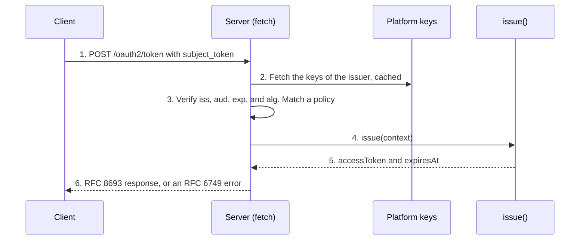

# Authorization Server [Serves the RFC 8693 token endpoint, and issues the credential of the host]

## Overview

`Server` from `handshakes/server` serves the token exchange ([RFC 8693](https://www.rfc-editor.org/rfc/rfc8693)) as a fetch handler. It verifies the subject token, matches a trust policy, and calls `issue`. The host mints the credential, such as an API key. `Server` stores no tokens.

A trust policy is a rule that maps the issuer, the audience, and the claims of a subject token to scopes and a lifetime. A policy matches identifiers that cannot change, such as `repository_id`, never names.



## Walkthrough

### Define Policies

A preset builds a policy from identifiers that cannot change. A renamed or re-created repository keeps its name but not its `repository_id`, so a preset never matches a name.

```ts [policies.ts]
import { Policy } from 'handshakes/server'

// Accepts the GitHub Actions tokens of one repository, on the main branch only.
export const policies = [
  Policy.githubActions({
    audience: 'https://auth.example.com',
    ref: 'refs/heads/main',
    repositoryId: '812345',
    scopes: ['data:read'],
  }),
]
```

| Preset                 | Matches                                                   | Default issuer                                |
| ---------------------- | --------------------------------------------------------- | --------------------------------------------- |
| `Policy.githubActions` | `repository_id`, and optionally `ref` and `environment`   | `https://token.actions.githubusercontent.com` |
| `Policy.vercel`        | `owner_id` and `project_id`, and optionally `environment` | `https://oidc.vercel.com/<team>`, from `team` |
| `Policy.from`          | Any exact claims                                          | None. `issuer` is required                    |

Claims match exactly. An array matches any of its values, and a number in the token compares as a string. A policy without claims would match every token of its issuer, so `Server.create` throws a `TypeError` for one.

### Create the Server

`issue` receives the verified claims, the matched policy, the scopes, the RFC 8707 resources, the request, and `expiresAt`. It returns the credential and its expiry.

```ts [server.ts]
import { Server } from 'handshakes/server'
import { policies } from './policies.js'

const server = Server.create({
  // Mints the credential. `keys` stands for the key store of the host.
  issue: async (context) => ({
    accessToken: await keys.mint({ expiresAt: context.expiresAt, scopes: context.scopes }),
    expiresAt: context.expiresAt,
  }),
  issuer: 'https://auth.example.com',
  policies,
})

// Serves the token endpoint and the metadata. Other paths return 404.
export default { fetch: server.fetch }
```

The client needs only the issuer. It reads the token endpoint from the metadata.

### Paths

| Request | Path                                                            | Response                                             |
| ------- | --------------------------------------------------------------- | ---------------------------------------------------- |
| `GET`   | `/.well-known/oauth-authorization-server`, then the issuer path | RFC 8414 metadata with `issuer` and `token_endpoint` |
| `POST`  | The issuer path, then `/oauth2/token`                           | The RFC 8693 response, or an RFC 6749 §5.2 error     |
| Other   | Any                                                             | `404` with `invalid_request`                         |

The metadata lists only the token exchange in `grant_types_supported`, and `none` in `token_endpoint_auth_methods_supported`. The trust policy authorizes the request, not a client secret.

### Request and Response

The client sends a form with the subject token. The server accepts `urn:ietf:params:oauth:token-type:jwt` and `urn:ietf:params:oauth:token-type:id_token` as `subject_token_type`, and a body of 64 KiB or less.

```http
POST /oauth2/token HTTP/1.1
Host: auth.example.com
Content-Type: application/x-www-form-urlencoded

grant_type=urn%3Aietf%3Aparams%3Aoauth%3Agrant-type%3Atoken-exchange&subject_token=eyJhbGciOi...&subject_token_type=urn%3Aietf%3Aparams%3Aoauth%3Atoken-type%3Ajwt&scope=data%3Aread
```

```json
{
  "access_token": "<credential>",
  "expires_in": 299,
  "issued_token_type": "urn:ietf:params:oauth:token-type:access_token",
  "scope": "data:read",
  "token_type": "Bearer"
}
```

The server verifies the signature with the keys of the issuer that the policy names. It accepts RS256, ES256, and EdDSA (Ed25519) only, and matches `iss` and `aud` exactly. The keys come from `jwks_uri` of the discovery document of the issuer, cached for 10 minutes.

### Lifetimes

`IssueContext.expiresAt` is the latest expiry of the credential. It is the earlier of the `exp` of the subject token and the current time plus the lifetime of the policy. A policy without `maxLifetime` uses `maxLifetime` of `Server.create`, 900 seconds by default.

`issue` must return an `expiresAt` of at most `IssueContext.expiresAt`. A later expiry is a defect of `issue`, and the request fails with `server_error`. So an issued credential never outlives the subject token that it replaces.

### Errors

Each refusal is an RFC 6749 §5.2 error response ([RFC 6749](https://www.rfc-editor.org/rfc/rfc6749#section-5.2)).

| `error`                  | Status | Cause                                                                                      |
| ------------------------ | ------ | ------------------------------------------------------------------------------------------ |
| `invalid_request`        | 400    | Another content type, a body over 64 KiB, no `subject_token`, or an unsupported token type |
| `unsupported_grant_type` | 400    | Another `grant_type`                                                                       |
| `invalid_grant`          | 400    | The subject token matches no trust policy                                                  |
| `invalid_scope`          | 400    | A requested scope is not a scope of the policy                                             |
| `invalid_target`         | 400    | A requested resource is not a resource of the policy                                       |
| `server_error`           | 500    | `issue` or the policy loader threw, or `issue` returned a later expiry                     |

Every refusal of the token itself has the same `invalid_grant` description. A caller cannot learn which check failed or which policies exist. A `server_error` response holds no detail of the failure.

## Recipes

### API Keys

`issue` can store a new API key with the expiry and the scopes of the exchange. The API then checks the key as before, and needs no change.

```ts [server.ts]
import { Server } from 'handshakes/server'
import { policies } from './policies.js'

const server = Server.create({
  issue: async (context) => {
    // Stores a key that expires with the exchange. `db` stands for the database of the host.
    const key = await db.apiKeys.create({
      expiresAt: new Date(context.expiresAt),
      repositoryId: String(context.claims['repository_id']),
      scopes: context.scopes,
    })
    return { accessToken: key.value, expiresAt: context.expiresAt }
  },
  issuer: 'https://auth.example.com',
  policies,
})
```

### Policies per Request

`policies` also accepts a function of the request, such as a function that reads a database table. The server calls it for each token request. A loaded policy without claims never matches.

```ts [server.ts]
import { Policy, Server } from 'handshakes/server'

const server = Server.create({
  issue,
  issuer: 'https://auth.example.com',
  // Loads the policies for each request. `db` stands for the database of the host.
  policies: async () => (await db.trustPolicies.findMany()).map((row) => Policy.from(row)),
})
```

### Resources

By default, a request that names an RFC 8707 resource is refused ([RFC 8707](https://www.rfc-editor.org/rfc/rfc8707)). `resources` of a policy lists the resources that a request may name. The server reads both the `resource` and the `audience` fields of the request.

```ts [policies.ts]
import { Policy } from 'handshakes/server'

export const policies = [
  Policy.githubActions({
    audience: 'https://auth.example.com',
    repositoryId: '812345',
    // A request may name this resource. Another resource receives `invalid_target`.
    resources: ['https://api.example.com'],
    scopes: ['data:read'],
  }),
]
```

`IssueContext.resources` holds the resources of the request, so `issue` can bind the credential to them.

### Issuer Paths

An issuer can have a path. RFC 8414 §3.1 inserts the well-known suffix before that path. Route both paths of the table below to `server.fetch`.

```ts [server.ts]
import { Server } from 'handshakes/server'

const server = Server.create({
  issue,
  // Serves the metadata and the token endpoint under the /auth path.
  issuer: 'https://example.com/auth',
  policies,
})
```

| Endpoint       | URL                                                               |
| -------------- | ----------------------------------------------------------------- |
| Metadata       | `https://example.com/.well-known/oauth-authorization-server/auth` |
| Token endpoint | `https://example.com/auth/oauth2/token`                           |

## More

- **Function:** [`Server.create`](/api/server/server/create) lists every option and the `issue` context.
- **Policies:** [`Policy`](/api/server/policy) describes each preset and its options.
- **Better Auth:** [Better Auth](/guides/better-auth) adds the same exchange to a Better Auth server.
- **Client:** [Token Exchange](/guides/token-exchange) sends the request from CI.
- **Tests:** [Testing](/guides/testing) verifies the server with real signed tokens.
