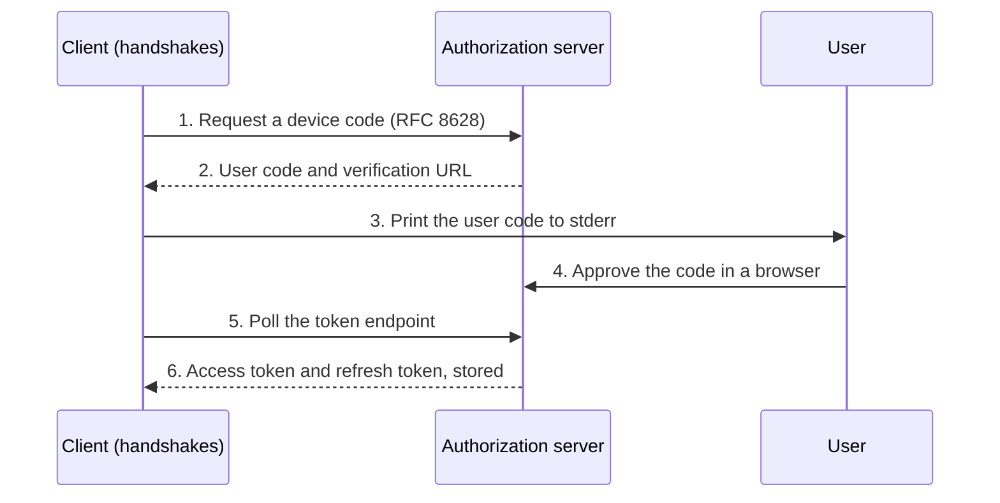

# Device Authorization [Runs the device grant once on a device, then refreshes the stored grant]

## Overview

On a device (such as a laptop), no platform signs a subject token for the code. `Client` runs the device authorization grant instead ([RFC 8628](https://www.rfc-editor.org/rfc/rfc8628)). The user approves a code once in a browser, and the client stores the grant.

A grant is the access token and the refresh token that the token endpoint issues. Before the access token expires, the client sends the refresh token for a new access token ([RFC 6749 §6](https://www.rfc-editor.org/rfc/rfc6749#section-6)). The user takes no further action.



## Walkthrough

### Register a Client

The authorization server must register an OAuth client for the device grant. Its grant types include `urn:ietf:params:oauth:grant-type:device_code` and `refresh_token`. The client ID is public. Many servers require no client secret for this grant.

### Create the Client

`clientId` names the registered client. `store` keeps the grant between runs. The default store, `Store.memory()`, keeps the grant for one process only.

```ts [client.ts]
import { Client } from 'handshakes'
import { Store } from 'handshakes/node'

export const client = Client.create({
  // The OAuth client that the server registers for the device grant.
  clientId: 'example-cli',
  issuer: 'https://auth.example.com',
  scope: 'data:read',
  // Keeps the grant in `~/.config/handshakes/grants`, shared by every process of the user.
  store: Store.file(),
})
```

`Store.file` writes each grant with mode 0600, and replaces the file atomically. If `XDG_CONFIG_HOME` is set, the directory is `$XDG_CONFIG_HOME/handshakes/grants`.

:::note
`Store.keychain`, a store in the system keychain, is not implemented yet.
:::

### Authorize

`client.authorize()` requests a device code, and prints the verification URL and the user code to stderr. Then it polls the token endpoint at the interval of the server, 5 seconds by default. After approval, it stores the grant.

```ts [login.ts]
import { client } from './client.js'

// Prints "Open <url> and confirm <code>." to stderr, then waits for approval.
const grant = await client.authorize()
```

`client.token()` also runs the device grant when no other method applies and the client is interactive. By default, the client is interactive when stdin is a TTY and `CI` is not set. Otherwise, `client.token()` throws `Client.AuthorizationRequiredError` and never prompts.

| Error                          | Thrown when                                     |
| ------------------------------ | ----------------------------------------------- |
| `DeviceGrant.DeniedError`      | The user denies the code                        |
| `DeviceGrant.ExpiredError`     | The code expires before approval                |
| `DeviceGrant.RejectedError`    | The server returns another RFC 6749 §5.2 error  |
| `DeviceGrant.UnsupportedError` | The server has no device authorization endpoint |

### Refresh

`client.token()` returns the cached access token while it is valid. When 60 seconds or 20% of its lifetime remain, the client reads the stored grant and sends the refresh token. A refresh token can rotate: the server issues a new one with each refresh.

The refresh runs under the lock of the store, which covers every process that shares the store. Inside the lock, the client reads the grant again. So only one process sends a refresh token, and the others read the new grant.

:::warning
A server such as Better Auth revokes every refresh token of the client and the user when an old refresh token is used again. The lock prevents this reuse. A custom store must implement `lock` across every process that shares it.
:::

If the refresh returns `invalid_grant`, the client deletes the stored grant, and the next call requires authorization. Another error throws `Client.RejectedError`.

### Status and Revoke

`status` names the method that applies, and never includes a token value. `invalidate` removes the cached access token only. `revoke` deletes the stored grant, then revokes the refresh token ([RFC 7009](https://www.rfc-editor.org/rfc/rfc7009)).

```ts [logout.ts]
import { client } from './client.js'

// Returns `method`, `expiresAt`, `refreshable`, and the `sub` of the access token.
const status = await client.status()

// Removes the cached access token. The next `token()` reads the store.
client.invalidate()

// Deletes the stored grant, then revokes the refresh token.
await client.revoke()
```

A revocation endpoint that returns `400` for an unknown token counts as revoked. If the server has no revocation endpoint, `revoke` only deletes the grant.

## Recipes

### CLI Commands

The CLI runs the same grant, and stores it in `Store.file()`. A library client with the same issuer, client, resource, and endpoints reads the same grant.

```sh
# Runs the device grant for the profile, and stores the grant.
handshakes authorize example

# Prints the access token, refreshed when it expires soon.
handshakes token example

# Revokes the refresh token and deletes the grant.
handshakes revoke example
```

### Custom Code Display

`onDeviceCode` receives the user code instead of stderr. The code has `userCode`, `verificationUri`, `verificationUriComplete` when the server returns one, and `expiresAt`.

```ts [client.ts]
import { Client } from 'handshakes'
import { Store } from 'handshakes/node'

const client = Client.create({
  clientId: 'example-cli',
  issuer: 'https://auth.example.com',
  // Shows the code in the interface of the program, instead of stderr.
  onDeviceCode: (code) => {
    console.log(`Open ${code.verificationUriComplete ?? code.verificationUri}`)
    console.log(`Code: ${code.userCode}, until ${new Date(code.expiresAt).toISOString()}`)
  },
  store: Store.file(),
})
```

### Client Secret

Some servers, such as Google, require a client secret on the device grant. Read the secret from an environment variable that the caller names. Never read it from command-line arguments, since other processes of the user can read them.

```ts [client.ts]
import { Client } from 'handshakes'
import { Store } from 'handshakes/node'

const client = Client.create({
  clientId: 'example-cli',
  // Reads the secret from the environment, never from argv.
  clientSecret: process.env['EXAMPLE_CLIENT_SECRET'],
  issuer: 'https://auth.example.com',
  store: Store.file(),
})
```

The [Google OAuth](/guides/services/google-oauth) guide shows a complete setup.

### Cancel the Wait

`authorize` takes a `signal`. After an abort, it stops polling and rejects with the reason of the signal.

```ts [login.ts]
import { client } from './client.js'

// Stops polling after 2 minutes.
const grant = await client.authorize({ signal: AbortSignal.timeout(120_000) })
```

## More

- **Client:** [`Client.create`](/api/core/client/create) lists every option and return value.
- **Grant:** [`DeviceGrant.start`](/api/core/device-grant/start) runs the grant without a client, for a custom flow.
- **Store:** [`Store.file`](/api/node/store/file) describes the file layout and the lock.
- **CLI:** [`handshakes authorize`](/cli/authorize) runs the grant from a shell.
- **CI:** [Token Exchange](/guides/token-exchange) covers code that runs on a platform.
