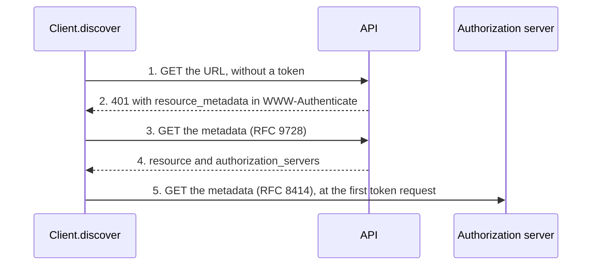

# Discovery [Finds the authorization server of an API from its metadata]

## Overview

An API that uses `Resource` serves protected resource metadata ([RFC 9728](https://www.rfc-editor.org/rfc/rfc9728)). The metadata names the resource identifier of the API and its authorization servers. `Client.discover` reads it, and returns a client for the first authorization server that it names.

The returned client uses the API as its resource ([RFC 8707](https://www.rfc-editor.org/rfc/rfc8707)), so its access tokens are for that API only. Code then needs only the URL of the API, and no `issuer`.



## Walkthrough

### From a Resource

With `resource`, the client reads the metadata at the well-known URL of the resource (RFC 9728 §3.1). The `resource` of the metadata must equal the option, or `Client.discover` throws `Metadata.ResourceNotFoundError`.

```ts [client.ts]
import { Client } from 'handshakes'

// Reads https://api.example.com/.well-known/oauth-protected-resource.
const client = await Client.discover({ resource: 'https://api.example.com' })
```

### From a URL

With `url`, the client sends one `GET` without credentials. It reads `resource_metadata` from the `WWW-Authenticate` header of the challenge (RFC 9728 §5), then reads that metadata.

```ts [client.ts]
import { Client } from 'handshakes'

// Discovers the authorization server from the challenge of the API.
const client = await Client.discover({ url: 'https://api.example.com/v1/items' })

// Sends the request with an access token for https://api.example.com.
const response = await client.fetch('https://api.example.com/v1/items')
```

The URL must lie within the resource of the metadata: the same origin, and a path at or below its path. Otherwise, `Client.discover` throws `Client.DiscoveryError`. So an API cannot direct a token to another resource.

### Other Options

`Client.discover` takes the options of `Client.create`, except `endpoints`, `issuer`, and `resource`. The discovered server becomes the issuer. Its own RFC 8414 metadata supplies the token endpoint, on the first token request.

| Error                            | Thrown when                                                                            |
| -------------------------------- | -------------------------------------------------------------------------------------- |
| `Client.DiscoveryError`          | The response has no `resource_metadata`, or the metadata names no authorization server |
| `Client.DiscoveryError`          | The URL lies outside the resource of the metadata                                      |
| `Metadata.ResourceNotFoundError` | The metadata is missing or invalid, or names another resource                          |

## Recipes

### CLI Requests

Without a profile, `handshakes fetch` discovers the authorization server from the URL. It stores the grant in `Store.file()`, and accepts `--client-id` and `--scope` for the device grant.

```sh
# Discovers the authorization server, then sends the request with an access token.
handshakes fetch https://api.example.com/v1/items
```

If discovery fails, the command exits with code 2.

### Device Grants

On a device (such as a laptop), the discovered client runs the device grant like any client. Pass `clientId` and a store.

```ts [client.ts]
import { Client } from 'handshakes'
import { Store } from 'handshakes/node'

const client = await Client.discover({
  // The OAuth client that the discovered server registers for the device grant.
  clientId: 'example-cli',
  store: Store.file(),
  url: 'https://api.example.com/v1/items',
})
```

### Metadata Functions

The `Metadata` functions send the discovery requests alone, for a custom flow.

```ts [metadata.ts]
import { Metadata } from 'handshakes'

// Reads RFC 8414 metadata, then OpenID Connect Discovery. `issuer` must match exactly.
const server = await Metadata.authorizationServer({ issuer: 'https://auth.example.com' })

// Reads RFC 9728 metadata from the well-known URL of the resource.
const api = await Metadata.protectedResource({ resource: 'https://api.example.com' })

// Parses the Bearer challenge of a response: `error`, `resourceMetadata`, and `scope`.
const challenge = Metadata.challenge(await fetch('https://api.example.com/v1/items'))
```

| Function                       | Returns                                                                                               |
| ------------------------------ | ----------------------------------------------------------------------------------------------------- |
| `Metadata.authorizationServer` | `issuer`, `tokenEndpoint`, `grantTypesSupported`, `deviceAuthorizationEndpoint`, `revocationEndpoint` |
| `Metadata.protectedResource`   | `resource`, `authorizationServers`, `scopesSupported`                                                 |
| `Metadata.challenge`           | `error`, `resourceMetadata`, `scope`, or `undefined` without a Bearer challenge                       |

## More

- **Function:** [`Client.discover`](/api/core/client/discover) lists every option.
- **Metadata:** [`Metadata.protectedResource`](/api/core/metadata/protected-resource) and [`Metadata.challenge`](/api/core/metadata/challenge) describe each request.
- **API:** [Token Verification](/guides/token-verification) serves the metadata and the challenge.
- **CLI:** [`handshakes fetch`](/cli/fetch) sends requests from a shell.
