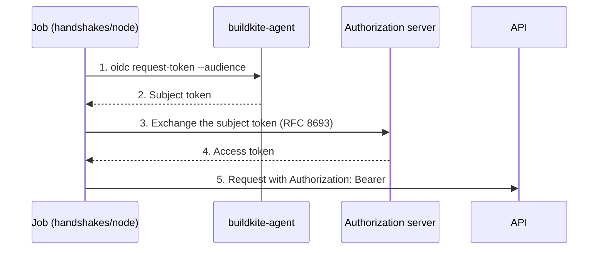

# Buildkite [Exchanges the OIDC token of a Buildkite job]

## Overview

The Buildkite agent signs an OIDC token for a job on request. This token is the subject token: the JWT that the platform signs for the running code. `Source.buildkite` of `handshakes/node` runs `buildkite-agent oidc request-token`, which returns a token for any audience.

The client exchanges the subject token at the authorization server (RFC 8693 token exchange). A trust policy on the server matches its claims. The source runs a child process, so it is in `handshakes/node`, not in the core entry.



## Walkthrough

:::steps

### Create the Client

The core `Source.defaults` do not include Buildkite. Pass `Source.defaults` of `handshakes/node`, which add `Source.buildkite`. The source detects the job when `BUILDKITE` is `true`.

```ts [test/api.test.ts]
import { Client } from 'handshakes'
import { Source } from 'handshakes/node'

const client = Client.create({
  issuer: 'https://auth.example.com',
  scope: 'data:read',
  // The defaults of handshakes/node, which include Source.buildkite.
  sources: Source.defaults,
})

const response = await client.fetch('https://api.example.com/v1/items')
```

The source runs `buildkite-agent oidc request-token --audience` with the audience of the client, `subjectAudience` else `issuer`. The agent reads its job token from the environment. The command times out after 30 seconds.

### Add a Policy

Buildkite has no preset, so write the policy with `Policy.from`. The issuer is `https://agent.buildkite.com`. The source requests no optional claims, so the token holds the default claims, such as `organization_slug` and `pipeline_slug`.

```ts [server.ts]
import { Policy, Server } from 'handshakes/server'

const server = Server.create({
  // `keys` stands for the API key store of the host.
  issue: async (context) => ({
    accessToken: await keys.mint({ expiresAt: context.expiresAt, scopes: context.scopes }),
    expiresAt: context.expiresAt,
  }),
  issuer: 'https://auth.example.com',
  policies: [
    Policy.from({
      audience: 'https://auth.example.com',
      // Accepts builds of the main branch of one pipeline.
      claims: { build_branch: 'main', organization_slug: 'acme', pipeline_slug: 'app' },
      id: 'buildkite:acme:app:main',
      issuer: 'https://agent.buildkite.com',
      scopes: ['data:read'],
    }),
  ],
})

export default { fetch: server.fetch }
```

:::

:::warning
`organization_slug` and `pipeline_slug` are names. A new pipeline with the same slug matches the same policy. Give the policy narrow scopes, and check the Buildkite documentation for claims that cannot change.
:::

## Recipes

### Pipeline Steps

The pipeline needs no setting for the token. The agent of the job provides `buildkite-agent`, and the source calls it.

```yaml [.buildkite/pipeline.yml]
steps:
  # The agent signs the subject token when the client requests one.
  - label: Test
    command: pnpm test
```

### Common Failures

`Source.RequestError` states the steps that resolve it.

| Cause                                | Step                                                                |
| ------------------------------------ | ------------------------------------------------------------------- |
| `buildkite-agent` is not on the path | Run the job on a Buildkite agent, which provides `buildkite-agent`. |
| The command fails                    | Update the Buildkite agent to a version with `oidc request-token`.  |

## More

- [Token Exchange](/guides/token-exchange)
- [Source.buildkite](/api/node/source/buildkite)
- [Policy](/api/server/policy)
- [Buildkite OIDC documentation](https://buildkite.com/docs/agent/v3/cli-oidc)
