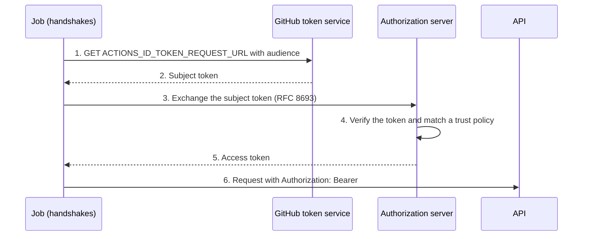

# GitHub Actions [Exchanges the OIDC token of a workflow job]

## Overview

GitHub Actions signs an OIDC token for each job that has the `id-token: write` permission. This token is the subject token: the JWT that the platform signs for the running code. `Source.githubActions` requests it for any audience, so the job stores no secret.

The client exchanges the subject token at the authorization server, the server that issues access tokens (RFC 8693 token exchange). A trust policy on the server matches the claims of the token, such as `repository_id`. The server then returns an access token that expires in minutes.



## Walkthrough

:::steps

### Grant the Permission

Add `permissions: id-token: write` to the job, or to the workflow. GitHub then sets `ACTIONS_ID_TOKEN_REQUEST_URL` and `ACTIONS_ID_TOKEN_REQUEST_TOKEN`. `Source.githubActions` detects the job when `GITHUB_ACTIONS` is `true`.

```yaml [.github/workflows/ci.yml]
name: CI
on: push

jobs:
  test:
    # The runner issues OIDC tokens only to a job with `id-token: write`.
    permissions:
      contents: read
      id-token: write # [!code hl]
    runs-on: ubuntu-latest
    steps:
      - uses: actions/checkout@v4
      - run: pnpm install
      - run: pnpm test
```

### Create the Client

`Client.create` uses `Source.defaults`, which include `Source.githubActions`. The source sends `GET` to `ACTIONS_ID_TOKEN_REQUEST_URL` with an `audience` parameter and the request token, then reads `value` from the response. The audience is `subjectAudience`, else `issuer`.

```ts [test/api.test.ts]
import { Client } from 'handshakes'

const client = Client.create({
  // Also the `aud` of the subject token, since `subjectAudience` is not set.
  issuer: 'https://auth.example.com',
  scope: 'data:read',
})

// Exchanges the subject token once, then sends the cached access token.
const response = await client.fetch('https://api.example.com/v1/items')
```

### Add a Policy

`Policy.githubActions` matches `repository_id`, which stays the same after a rename. It never matches the repository name, since a re-created repository can take the name again. `ref` and `environment` narrow the policy further.

```ts [server.ts]
import { Policy, Server } from 'handshakes/server'

const server = Server.create({
  // `keys` stands for the API key store of the host.
  issue: async (context) => ({
    accessToken: await keys.mint({ expiresAt: context.expiresAt, scopes: context.scopes }),
    expiresAt: context.expiresAt,
  }),
  issuer: 'https://auth.example.com',
  policies: [
    Policy.githubActions({
      audience: 'https://auth.example.com',
      // Accepts jobs of the main branch only.
      ref: 'refs/heads/main',
      repositoryId: '812345',
      scopes: ['data:read'],
    }),
  ],
})

export default { fetch: server.fetch }
```

The GitHub CLI prints the ID of a repository.

```sh
# Prints the repository ID, such as 812345
gh api repos/acme/app --jq .id
```

:::

## Recipes

### Deployment Environments

If a job names a deployment environment, its token carries the `environment` claim. Set `environment` in the policy to accept only that environment, such as the production deployment job.

```ts [server.ts]
import { Policy } from 'handshakes/server'

const policy = Policy.githubActions({
  audience: 'https://auth.example.com',
  // Matches jobs with `environment: production` in the workflow.
  environment: 'production',
  repositoryId: '812345',
  scopes: ['data:write'],
})
```

### Several Refs

`Policy.githubActions` takes one `ref`. For several refs, write the policy with `Policy.from`. A claim with an array matches any of its values.

```ts [server.ts]
import { Policy } from 'handshakes/server'

const policy = Policy.from({
  audience: 'https://auth.example.com',
  // Accepts the main branch and the release branch.
  claims: { ref: ['refs/heads/main', 'refs/heads/release'], repository_id: '812345' },
  id: 'githubActions:812345:release',
  issuer: 'https://token.actions.githubusercontent.com',
  scopes: ['data:read'],
})
```

### Common Failures

`Source.RequestError` and `Exchange.RejectedError` state the steps that resolve them.

| Error                                         | Step                                                                                                   |
| --------------------------------------------- | ------------------------------------------------------------------------------------------------------ |
| `ACTIONS_ID_TOKEN_REQUEST_URL is not set.`    | Add `permissions: id-token: write` to the job, or to the workflow.                                     |
| The request returned HTTP 401 or 403          | Check that the job may request OIDC tokens, such as `permissions: id-token: write` on GitHub Actions.  |
| The token response has no `value`             | Check that the runner supports OIDC tokens, then run the job again.                                    |
| `Exchange.RejectedError` with `invalid_grant` | Check that a trust policy on the server matches the issuer, audience, and claims of the subject token. |

Run `handshakes status` in the job to print the source that detects the platform. It never prints a token.

```yaml [.github/workflows/ci.yml]
steps:
  # Prints `githubActions` as the detected source.
  - run: pnpm exec handshakes status
```

## More

- [Token Exchange](/guides/token-exchange)
- [Authorization Server](/guides/authorization-server)
- [Source](/api/core/source)
- [Policy](/api/server/policy)
- [GitHub OIDC documentation](https://docs.github.com/en/actions/security-for-github-actions/security-hardening-your-deployments/about-security-hardening-with-openid-connect)
