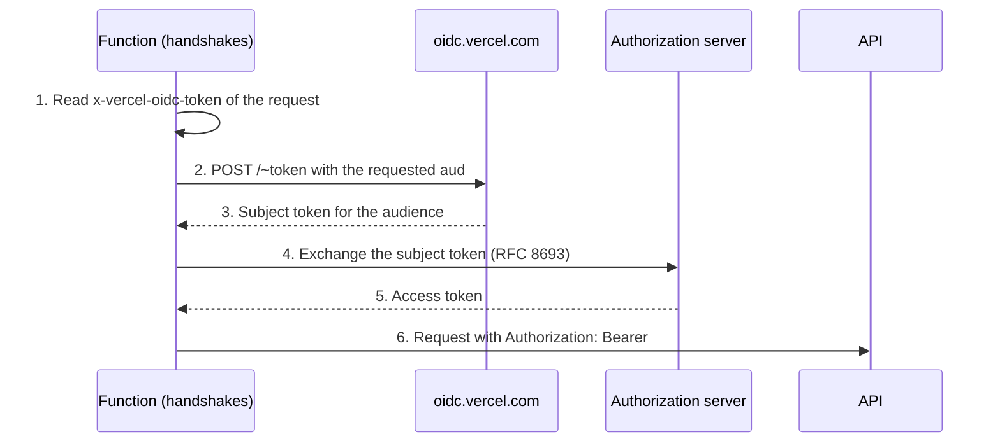

# Vercel [Exchanges the OIDC token of a Vercel deployment]

## Overview

Vercel signs an OIDC token for each deployment of a project with OIDC federation. This token is the subject token: the JWT that the platform signs for the running code. Its default audience is the team, such as `https://vercel.com/acme`.

`Source.vercel` reads the token of the current request in Vercel Functions, else `VERCEL_OIDC_TOKEN`. For another audience, it exchanges the token at Vercel for one with the requested `aud`. The client then exchanges that subject token at the authorization server (RFC 8693 token exchange).



## Walkthrough

:::steps

### Enable OIDC Federation

Turn on OIDC federation in the security settings of the Vercel project. Then each deployment receives a token. `Source.vercel` detects the deployment when `VERCEL` is `1`, when `VERCEL_OIDC_TOKEN` is set, or when the current request holds a token.

### Create the Client

Creating a client sends no request. So one client can serve every request of a function instance, and cache its access token. Request the token inside a request, since Vercel Functions hold the token in the request headers.

```ts [api/items.ts]
import { Client } from 'handshakes'

// One client for the instance. It caches the access token across requests.
const client = Client.create({ issuer: 'https://auth.example.com', scope: 'data:read' })

export async function GET() {
  // Inside a request, `Source.vercel` reads the token of the request.
  const response = await client.fetch('https://api.example.com/v1/items')
  return new Response(response.body, { status: response.status })
}
```

The client requests a subject token for `subjectAudience`, else `issuer`. If the token already carries that `aud`, the source returns it unchanged. Otherwise it sends `POST https://oidc.vercel.com/~token` with `aud` and `token`, and reads `token` from the response.

### Add a Policy

`Policy.vercel` matches `owner_id` and `project_id`, never the team or project name. `team` sets the team issuer, `https://oidc.vercel.com/acme`. Without `environment`, preview and production deployments match alike.

```ts [server.ts]
import { Policy, Server } from 'handshakes/server'

const server = Server.create({
  // `keys` stands for the API key store of the host.
  issue: async (context) => ({
    accessToken: await keys.mint({ expiresAt: context.expiresAt, scopes: context.scopes }),
    expiresAt: context.expiresAt,
  }),
  issuer: 'https://auth.example.com',
  policies: [
    Policy.vercel({
      audience: 'https://auth.example.com',
      // Accepts production deployments only.
      environment: 'production',
      ownerId: 'team_acme',
      projectId: 'prj_app',
      scopes: ['data:read'],
      team: 'acme',
    }),
  ],
})

export default { fetch: server.fetch }
```

:::

## Recipes

### Local Development

On a device (such as a laptop), `vercel env pull` writes `VERCEL_OIDC_TOKEN` to `.env.local`. The token is valid for 12 hours. Load the file into the environment of the process, such as with `node --env-file`.

```sh
# Links the directory to the project, then writes VERCEL_OIDC_TOKEN to .env.local.
vercel link
vercel env pull

# Runs the script with the token in its environment.
node --env-file=.env.local script.ts
```

A token from `vercel env pull` carries the `development` environment. If the policy sets `environment: 'production'`, add a second policy for `development`.

### Global Issuer

If the project uses another issuer than the team issuer, set `issuer` instead of `team`. `Policy.vercel` throws a `TypeError` when neither is set.

```ts [server.ts]
import { Policy } from 'handshakes/server'

const policy = Policy.vercel({
  audience: 'https://auth.example.com',
  // The issuer of the tokens, in place of the team issuer.
  issuer: 'https://oidc.vercel.com',
  ownerId: 'team_acme',
  projectId: 'prj_app',
  scopes: ['data:read'],
})
```

### Common Failures

`Source.RequestError` states the steps that resolve it.

| Error                                | Step                                                                                                                                |
| ------------------------------------ | ----------------------------------------------------------------------------------------------------------------------------------- |
| `No Vercel OIDC token is available.` | On Vercel Functions, request the token inside a request. For local development, run `vercel env pull` to write `VERCEL_OIDC_TOKEN`. |
| The exchange response has no `token` | Check that the project enables OIDC federation in its Vercel settings.                                                              |
| The request returned HTTP 401 or 403 | Check that the job may request OIDC tokens, such as `permissions: id-token: write` on GitHub Actions.                               |

## More

- [Vercel AI Gateway](/guides/services/vercel-ai-gateway)
- [Token Exchange](/guides/token-exchange)
- [Source](/api/core/source)
- [Policy](/api/server/policy)
- [Vercel OIDC documentation](https://vercel.com/docs/oidc)
