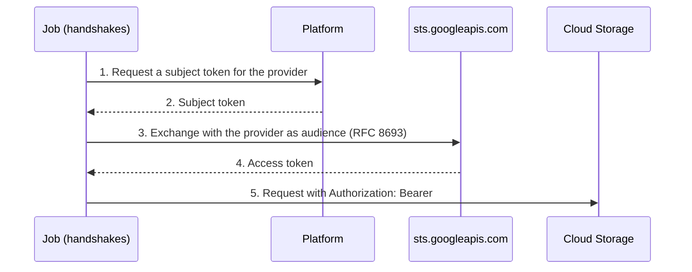

# Google Cloud STS [Exchanges a platform token for a Google Cloud access token]

## Overview

:::note
This integration has no automated test in this repository yet.
:::

Google Cloud Security Token Service (STS) is the token endpoint of workload identity federation. It accepts the OIDC token of a platform, such as GitHub Actions or Vercel, in a token exchange (RFC 8693). It returns an access token for Google Cloud APIs, such as Cloud Storage.

A workload identity pool holds one provider for each platform. The client sends the provider as the RFC 8693 `audience` field, so the field differs for each source. A function of the source returns it.



## Walkthrough

:::steps

### Create the Pool

Create a workload identity pool, and one provider for each platform. Grant the principals of the pool access to the resources that the job reads. The Google Cloud documentation describes the setup.

### Create the Client

STS serves no metadata for the exchange, so set `endpoints.token`. `parameters` and `subjectAudience` are functions of the detected source. Each returns the value for the provider of that platform.

```ts [read.ts]
import { Client } from 'handshakes'

/** Returns the resource name of the provider for a platform. */
const provider = (name: string) =>
  `//iam.googleapis.com/projects/123456789/locations/global/workloadIdentityPools/ci/providers/${name}`

const client = Client.create({
  endpoints: { token: 'https://sts.googleapis.com/v1/token' },
  // The RFC 8693 `audience` field names the provider of the detected platform.
  parameters: (source) => ({
    audience: provider(source.name === 'vercel' ? 'vercel' : 'github'),
  }),
  scope: 'https://www.googleapis.com/auth/cloud-platform',
  // `aud` of the subject token: an audience that the provider allows.
  subjectAudience: (source) => `https:${provider(source.name === 'vercel' ? 'vercel' : 'github')}`,
})

// Lists the objects of a bucket with the exchanged token.
const response = await client.fetch('https://storage.googleapis.com/storage/v1/b/acme-data/o')
```

### Run the Job

On GitHub Actions, the job needs `permissions: id-token: write`. On Vercel, the project needs OIDC federation. The platform guides show both setups.

```yaml [.github/workflows/read.yml]
jobs:
  read:
    # Lets the job request the subject token.
    permissions:
      contents: read
      id-token: write
    runs-on: ubuntu-latest
    steps:
      - uses: actions/checkout@v4
      - run: pnpm install
      - run: node read.ts
```

:::

## Recipes

### Allowed Audiences

A provider allows the audience of its own resource name with an `https:` prefix, unless its settings list other audiences. If the provider lists a custom audience, return that value from `subjectAudience`.

```ts [read.ts]
import { Client } from 'handshakes'

const client = Client.create({
  endpoints: { token: 'https://sts.googleapis.com/v1/token' },
  parameters: {
    audience:
      '//iam.googleapis.com/projects/123456789/locations/global/workloadIdentityPools/ci/providers/github',
  },
  scope: 'https://www.googleapis.com/auth/cloud-platform',
  // A custom audience in the allowed audiences of the provider.
  subjectAudience: 'https://auth.example.com',
})
```

### The CLI

A [CLI profile](/cli/configuration) holds the same settings. `sources` holds the `parameters` and `subjectAudience` of each platform, the JSON form of the functions above.

```json [handshakes.json]
{
  "profiles": {
    "gcp": {
      "endpoints": { "token": "https://sts.googleapis.com/v1/token" },
      "scope": "https://www.googleapis.com/auth/cloud-platform",
      "sources": {
        "githubActions": {
          "parameters": {
            "audience": "//iam.googleapis.com/projects/123456789/locations/global/workloadIdentityPools/ci/providers/github"
          },
          "subjectAudience": "https://iam.googleapis.com/projects/123456789/locations/global/workloadIdentityPools/ci/providers/github"
        },
        "vercel": {
          "parameters": {
            "audience": "//iam.googleapis.com/projects/123456789/locations/global/workloadIdentityPools/ci/providers/vercel"
          },
          "subjectAudience": "https://iam.googleapis.com/projects/123456789/locations/global/workloadIdentityPools/ci/providers/vercel"
        }
      }
    }
  }
}
```

```sh
# Lists the objects of a bucket with the exchanged token
curl -H "Authorization: Bearer $(handshakes token gcp)" https://storage.googleapis.com/storage/v1/b/acme-data/o
```

## More

- [Token Exchange](/guides/token-exchange)
- [GitHub Actions](/guides/platforms/github-actions)
- [Vercel](/guides/platforms/vercel)
- [Client.create](/api/core/client/create)
- [Google workload identity federation documentation](https://cloud.google.com/iam/docs/workload-identity-federation)
