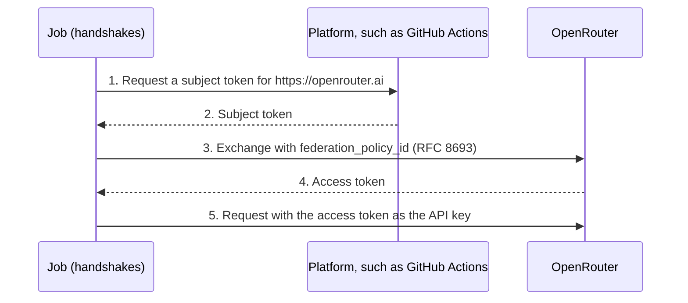

# OpenRouter [Replaces OPENROUTER_API_KEY with an exchanged token]

## Overview

:::note
This integration has no automated test in this repository yet.
:::

OpenRouter is both the authorization server and the API. Its token endpoint accepts the OIDC token of a platform, such as GitHub Actions, in a token exchange (RFC 8693). A federation policy of OpenRouter maps that subject token to an OpenRouter API key.

The client sends the ID of the federation policy as an extra field of the exchange. The token that it returns replaces `OPENROUTER_API_KEY`. It expires in 15 minutes or less, and never after the subject token.



## Walkthrough

:::steps

### Create a Policy

Create a federation policy in OpenRouter for the issuer of the platform, such as `https://token.actions.githubusercontent.com`. Set its audience to `https://openrouter.ai`. The OpenRouter documentation describes the setup and the plan that it requires.

### Create the Client

OpenRouter serves no metadata for the exchange, so set `endpoints.token`. Set `subjectAudience` to the audience of the policy, since the client has no `issuer`. `parameters` adds `federation_policy_id` to the token request.

```ts [summarize.ts]
import { createOpenRouter } from '@openrouter/ai-sdk-provider'
import { generateText } from 'ai'
import { Client } from 'handshakes'

const client = Client.create({
  endpoints: { token: 'https://openrouter.ai/api/v1/oauth/token' },
  // Names the federation policy, which maps the subject token to an OpenRouter API key.
  parameters: { federation_policy_id: '<policy id>' },
  // `aud` of the subject token. Equals the audience of the policy.
  subjectAudience: 'https://openrouter.ai',
})

// Replaces OPENROUTER_API_KEY.
const token = await client.token()
const openrouter = createOpenRouter({ apiKey: token.value })

const { text } = await generateText({
  model: openrouter('anthropic/claude-sonnet-4.5'),
  prompt: 'Summarize the release notes.',
})
```

### Grant the Permission

On GitHub Actions, the job needs `permissions: id-token: write`. Other platforms have their own setup, as their guides show.

```yaml [.github/workflows/release.yml]
jobs:
  summarize:
    # Lets the job request the subject token.
    permissions:
      contents: read
      id-token: write
    runs-on: ubuntu-latest
    steps:
      - uses: actions/checkout@v4
      - run: pnpm install
      - run: node summarize.ts
```

:::

## Recipes

### Several Platforms

`parameters` and `subjectAudience` also take a function of the detected source. If each platform has its own federation policy, return the ID of the policy for the source.

```ts [summarize.ts]
import { Client } from 'handshakes'

const client = Client.create({
  endpoints: { token: 'https://openrouter.ai/api/v1/oauth/token' },
  // Selects the federation policy of the platform that runs the code.
  parameters: (source) => ({
    federation_policy_id: source.name === 'vercel' ? '<vercel policy id>' : '<github policy id>',
  }),
  subjectAudience: 'https://openrouter.ai',
})
```

### The CLI

A [CLI profile](/cli/configuration) holds the same settings. `handshakes exec` then sets `OPENROUTER_API_KEY` for a command that reads it, with no change to its code.

```json [handshakes.json]
{
  "profiles": {
    "openrouter": {
      "endpoints": { "token": "https://openrouter.ai/api/v1/oauth/token" },
      "env": "OPENROUTER_API_KEY",
      "parameters": { "federation_policy_id": "<policy id>" },
      "subjectAudience": "https://openrouter.ai"
    }
  }
}
```

```sh
# Runs the script with an exchanged token in OPENROUTER_API_KEY
handshakes exec openrouter -- node summarize.ts
```

If each platform has its own federation policy, `sources` holds the `parameters` of each source, such as `{ "vercel": { "parameters": { "federation_policy_id": "<vercel policy id>" } } }`.

## More

- [Token Exchange](/guides/token-exchange)
- [GitHub Actions](/guides/platforms/github-actions)
- [Client.create](/api/core/client/create)
- [OpenRouter documentation](https://openrouter.ai/docs)
