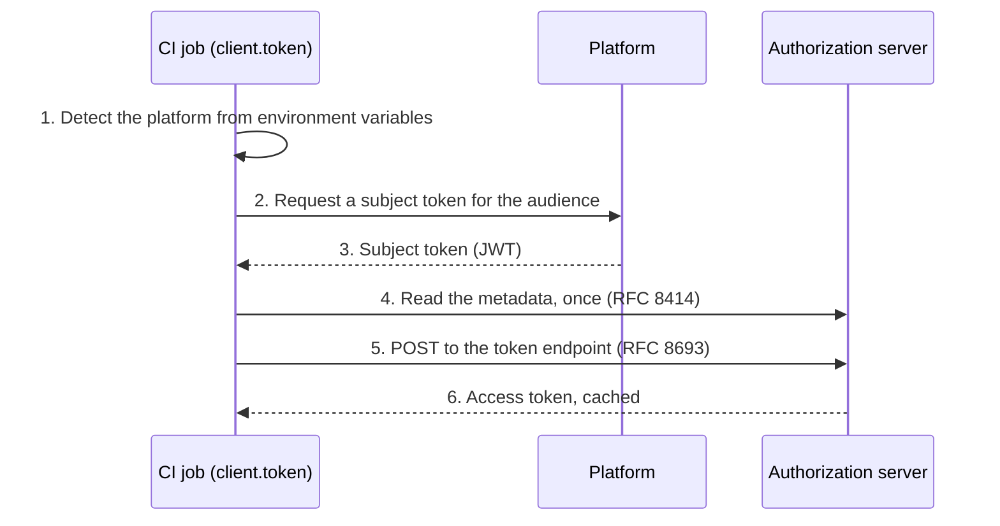

# Token Exchange [Exchanges the OIDC token of the platform for an access token in CI and on servers]

## Overview

In CI and on servers, a platform such as GitHub Actions signs an OIDC token for the running code. This JWT is the subject token. `Client` exchanges it at the token endpoint of an authorization server for an access token ([RFC 8693](https://www.rfc-editor.org/rfc/rfc8693)).

The authorization server verifies the subject token and issues the access token. The API verifies the access token. An access token expires in minutes, and never after the subject token that it replaces. The code stores no API key.



## Walkthrough

### Create the Client

`Client.create` takes the issuer of the authorization server. The issuer is the identifier of the server, such as `https://auth.example.com`. Creating the client sends no request.

```ts [client.ts]
import { Client } from 'handshakes'

// Exchanges subject tokens at the token endpoint of auth.example.com.
export const client = Client.create({
  issuer: 'https://auth.example.com',
  scope: 'data:read',
})
```

In CI, the client needs no `clientId`. The trust policy on the server authorizes the subject token. The [Authorization Server](/guides/authorization-server) guide shows the server side.

### Request a Token

`client.token()` runs the resolution order. The exchange is the first method after a cached token:

1. The client checks each source of `Source.defaults`, in order. The first source whose `detect` returns `true` supplies the subject token.
2. The source requests a subject token whose `aud` is `subjectAudience`, else `issuer`.
3. The client reads the token endpoint from the metadata of the issuer, once for each client.
4. The client sends the subject token, then caches the access token.

```ts [client.ts]
// Returns the cached access token, or exchanges a new subject token.
const token = await client.token()

// `exchange`, since a source detected its platform.
console.log(token.method)
```

### Send a Request

`client.fetch` sends a request with `Authorization: Bearer`. After a `401` response, it removes the cached token and retries once with a new token. It returns a redirect response unfollowed, so a redirect cannot carry the token to another host.

```ts [client.ts]
// Sends the request with the access token in the Authorization header.
const response = await client.fetch('https://api.example.com/v1/items')
```

If `resource` is set, `client.fetch` throws `Client.ResourceError` for a URL outside that resource. The access token is for that API only.

### Lifetimes

The client never keeps an access token longer than the subject token that it replaces.

| Value                         | Rule                                                                       |
| ----------------------------- | -------------------------------------------------------------------------- |
| Expiry of the access token    | The earlier of `expires_in` of the response and `exp` of the subject token |
| Response without `expires_in` | The access token expires with the subject token                            |
| Replacement of a cached token | When 60 seconds or 20% of its lifetime remain, whichever is more           |
| Concurrent calls of `token()` | One request in flight for each client. Other calls receive its result      |

### Failures

A detected source that fails throws `Source.RequestError`, and the client tries no other method. A stored grant never replaces the subject token, since it can belong to a different identity. The `steps` of the error state the fix, such as `permissions: id-token: write`.

A server that rejects the exchange returns an RFC 6749 §5.2 error. The client throws `Exchange.RejectedError` with the `error` code, such as `invalid_grant` for a subject token that matches no trust policy.

## Recipes

### Subject Audience

Some servers require a subject token for an audience other than the issuer. Set `subjectAudience` to the `aud` that the server expects.

```ts [client.ts]
import { Client } from 'handshakes'

const client = Client.create({
  issuer: 'https://auth.example.com',
  // `aud` of the subject token. Default: the issuer.
  subjectAudience: 'https://api.example.com',
})
```

### Per-Source Parameters

`parameters` adds fields to the token request. `parameters` and `subjectAudience` each accept a value, or a function of the detected source. A function suits a server with one provider for each platform, such as [Google Cloud STS](/guides/services/google-sts).

```ts [client.ts]
import { Client } from 'handshakes'

const client = Client.create({
  issuer: 'https://auth.example.com',
  // Sends the RFC 8693 `audience` field for the provider of the detected platform.
  parameters: (source) => ({ audience: `https://auth.example.com/providers/${source.name}` }),
})
```

A parameter never replaces `grant_type`, `subject_token`, or `subject_token_type`. The client writes those fields after the parameters.

### Explicit Endpoints

A server without RFC 8414 metadata needs `endpoints`. Then `issuer` is optional. Without `issuer`, set `subjectAudience`, or the first exchange throws a `TypeError`.

```ts [client.ts]
import { Client } from 'handshakes'

const client = Client.create({
  // The token endpoint of a server that serves no metadata, such as OpenRouter.
  endpoints: { token: 'https://openrouter.ai/api/v1/oauth/token' },
  parameters: { federation_policy_id: '<policy id>' },
  subjectAudience: 'https://openrouter.ai',
})
```

The [OpenRouter](/guides/services/openrouter) guide shows the complete setup.

### Custom Source

`Source.from` types a source for a platform that `Source.defaults` does not cover. `detect` reads environment variables only, with no I/O. `token` returns a JWT for `context.audience`.

```ts [client.ts]
import { Client, Source } from 'handshakes'

// A platform that writes its OIDC token to `EXAMPLE_OIDC_TOKEN`.
const example = Source.from({
  detect: (env) => env['EXAMPLE_CI'] === 'true',
  name: 'example',
  async token(context) {
    const value = context.env['EXAMPLE_OIDC_TOKEN']
    if (!value)
      throw new Source.RequestError({
        message: 'EXAMPLE_OIDC_TOKEN is not set.',
        source: 'example',
        steps: ['Turn on OIDC tokens for the job.'],
      })
    return value
  },
})

const client = Client.create({
  issuer: 'https://auth.example.com',
  // Checks the custom source first, then the defaults, in this order.
  sources: [example, ...Source.defaults],
})
```

The client decodes the token of every source, and compares its `aud` with the requested audience. A mismatch throws `Identity.AudienceError`, and the token is not sent.

## More

- **Client:** [`Client.create`](/api/core/client/create) lists every option and return value.
- **Request:** [`Exchange.request`](/api/core/exchange/request) sends one exchange, for a custom flow.
- **Sources:** [`Source`](/api/core/source) lists the platforms and their audiences.
- **Platforms:** [GitHub Actions](/guides/platforms/github-actions) and [Vercel](/guides/platforms/vercel) show the setup of each platform.
- **Interactive:** [Device Authorization](/guides/device-authorization) covers code on a device (such as a laptop).
