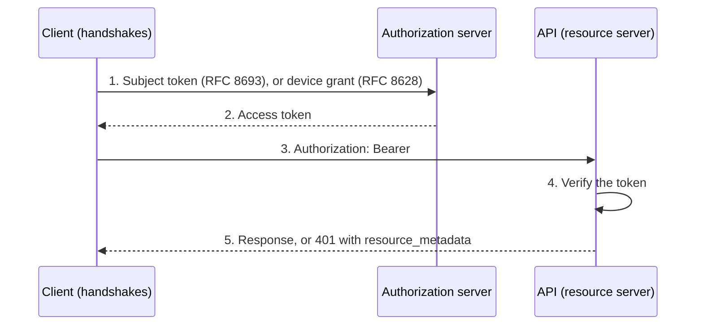
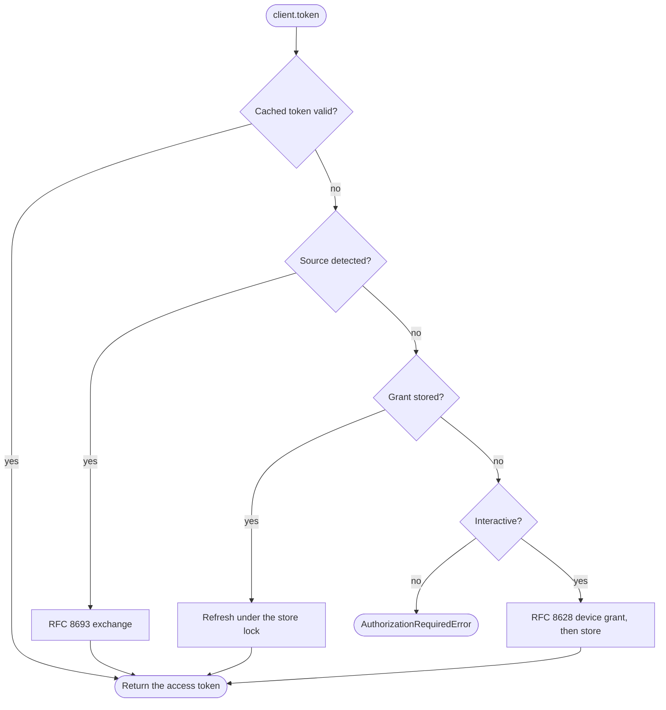

# Concepts [The roles, the terms, and the order in which a client resolves a token]

## Roles

Handshakes covers the three roles of OAuth. The client obtains an access token from the authorization server, then sends it to the API (the resource server).

| Role                 | Entry                                                       | Responsibility                                                                                               |
| -------------------- | ----------------------------------------------------------- | ------------------------------------------------------------------------------------------------------------ |
| Client               | `handshakes`, `handshakes/node`, the CLI                    | Detects the subject token or runs the device grant, then exchanges or refreshes, caches, and sends the token |
| Authorization server | `handshakes/server` (`Server`), or `handshakes/better-auth` | Verifies the subject token, matches a trust policy, and returns the credential that the host issues          |
| API                  | `handshakes/server` (`Resource`)                            | Verifies the access token or a subject token, serves RFC 9728 metadata, and returns the `401` challenge      |

## Terms

| Term          | Meaning                                                                                                                |
| ------------- | ---------------------------------------------------------------------------------------------------------------------- |
| Subject token | A JWT that the platform signs for the running code, such as a GitHub Actions OIDC token                                |
| Access token  | The token that the API verifies. It expires in minutes                                                                 |
| Grant         | A stored access token and refresh token from the device grant                                                          |
| Source        | Where a subject token comes from, such as GitHub Actions or Vercel                                                     |
| Trust policy  | A server rule that maps the issuer and claims of a subject token to scopes and a lifetime                              |
| Issuer        | The identifier of an authorization server or a platform, which is the `iss` of its tokens                              |
| Resource      | The identifier of an API ([RFC 8707](https://www.rfc-editor.org/rfc/rfc8707)), which is the `aud` of its access tokens |

## Setups

An API can take one of three setups. The client is the same in each.

| Setup                                 | Authorization server                                     | API                                                                        |
| ------------------------------------- | -------------------------------------------------------- | -------------------------------------------------------------------------- |
| Exchange for the API's own credential | `Server` in the API, with `issue` that mints an API key  | The existing check of the API key                                          |
| Exchange at a separate server         | Better Auth with `tokenExchange`, or any RFC 8693 server | `Resource` with `authorizationServers`                                     |
| No exchange                           | None                                                     | `Resource` with `policies`, which accepts platform subject tokens directly |

The last setup is the least work. But the API then accepts a token for the full lifetime that the platform sets, and cannot narrow its scopes.

## Resolution Order

`Client` and the CLI resolve an access token in one order. Each step runs only when the step before it does not apply.

1. **Cache:** A cached access token is valid until 60 seconds or 20% of its lifetime remain, whichever is more.
2. **Exchange:** The first source that detects its platform supplies the subject token. If that source fails, the client throws. It never falls through to the next source, since that can select a different identity.
3. **Refresh:** A stored grant refreshes under a lock that covers every process using the store. A server such as Better Auth revokes every refresh token of the client and user when an old one is reused.
4. **Device grant:** The device grant runs only when stdin is a TTY and `CI` is not set, or when `interactive` is `true`.

## Security

- **Token values:** Subject tokens, access tokens, refresh tokens, and device codes never appear in errors, logs, `status`, or MCP output. Only `token()`, `Identity.token()`, and the CLI `token` command return one.
- **Audience:** Every subject token has an explicit audience, so a token for one service never reaches another. For a source with a fixed audience, the client compares `aud` before it sends the token.
- **Claims:** The client decodes the claims of a token for logs and errors only, and never trusts them. The server verifies the signature.
- **Lifetime:** An issued token never outlives the subject token that it replaces.
- **Identifiers:** A trust policy matches identifiers that cannot change, such as `repository_id` and `project_id`, never names.
